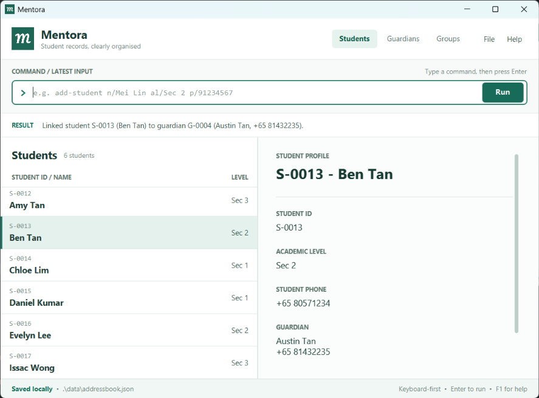

# Mentora

* **Mentora is a keyboard-first desktop application for managing student and guardian contacts at small private tuition centres in Singapore.**
  * It is designed for coordinators who manage approximately 30-200 active and prospective secondary-school students.
  * It helps coordinators keep related student and guardian information together, retrieve the right contacts quickly, and maintain accurate enrolment-related records without relying on cumbersome spreadsheets or mouse-heavy systems.
* Mentora supports:
  * adding, updating, viewing, searching, and deleting student records;
  * adding, finding, and updating guardian records;
  * linking or unlinking a student's guardian while allowing siblings to share one guardian record;
  * creating, browsing, and deleting subject or class groups and assigning or unassigning students;
  * displaying a student's academic level, assignments, and linked guardian; and
  * saving records locally, restoring them when the application is reopened, and protecting an unreadable data file from being overwritten.
* Mentora is optimized for **fast typed commands** and clear feedback, while retaining a graphical interface for viewing student profiles and contact information.
* Mentora is intended for one coordinator using the application locally at a time. It does not manage attendance, grades, fees, payroll, accounting, lesson content, or direct messaging through WhatsApp, SMS, or email.
* This project is based on the AddressBook-Level3 project created by the [SE-EDU initiative](https://se-education.org)
* For usage instructions, see the [User Guide](docs/UserGuide.md).
* For current capabilities and limitations, see the [User Guide's scope and limitations](docs/UserGuide.md#scope-and-limitations).
* For downloads and version-specific release notes, see [GitHub Releases](https://github.com/AY2627S1-CS2103T-T10-4/tp/releases).
* For development and architecture details, see the [Developer Guide](docs/DeveloperGuide.md).
