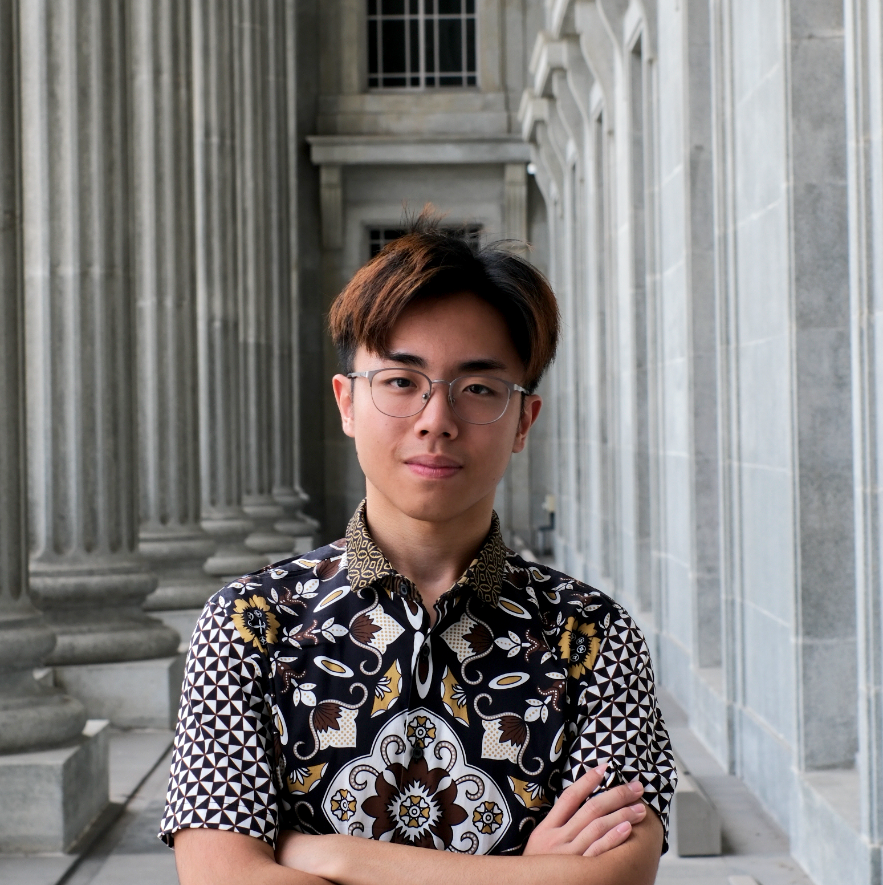
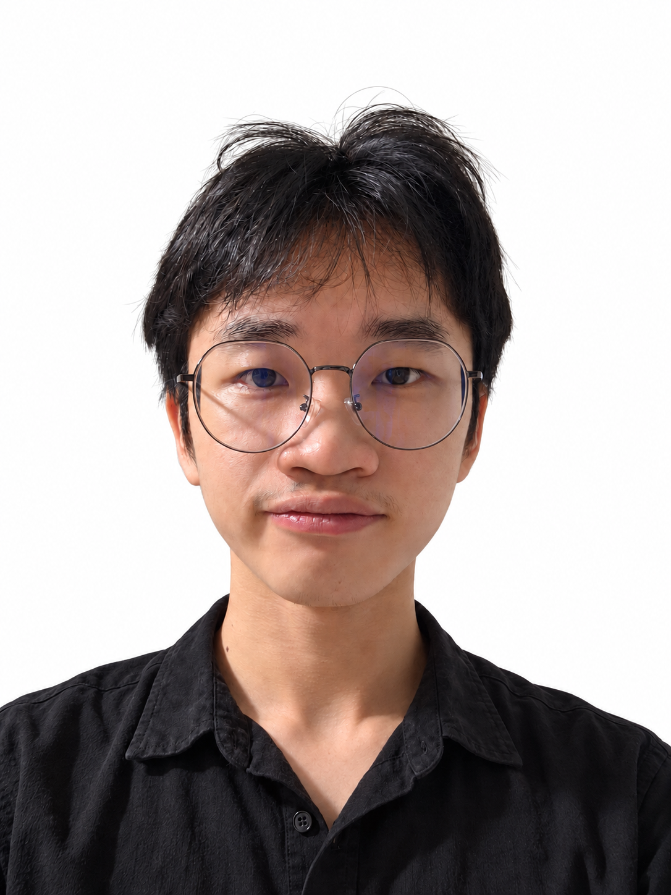
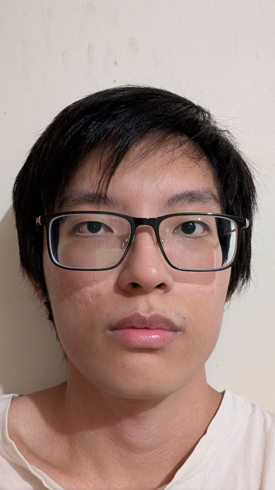
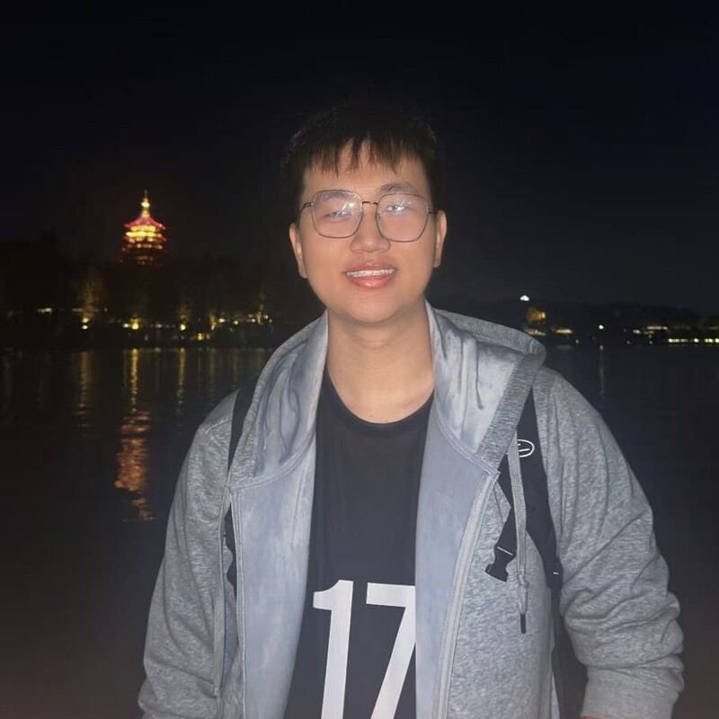
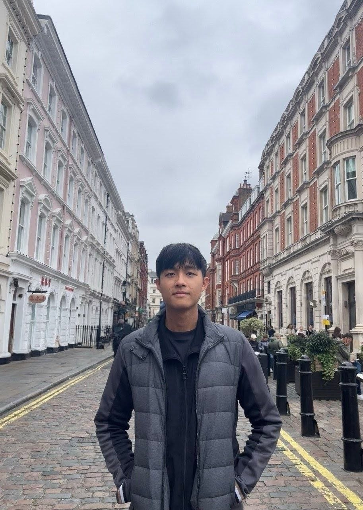

We are a team based in the [School of Computing, National University of Singapore](https://www.comp.nus.edu.sg).

For questions and bug reports, use the [team issue tracker](https://github.com/AY2627S1-CS2103T-T10-4/tp/issues).

## Project team

### Valentino Nathan

[[github](https://github.com/valentinonathan)]
[[portfolio](team/valentino-nathan.md)]

* Role: Developer
* Responsibilities: User interface and navigation; guardian registration and listing; group creation and deletion.

### Christian Alexander

[[github](http://github.com/chrsxndr)]
[[portfolio](team/chrsxndr.md)]

* Role: Developer
* Responsibilities: Student profiles; guardian linking, unlinking, and search; offline help; release documentation and CI.

### Gabriel Chan

[[github](https://github.com/HIIMHEY)]
[[portfolio](team/hiimhey.md)]

* Role: Developer
* Responsibilities: Group catalogue and assignments; data-loading recovery; regression testing; manual-testing documentation.

### Koh Wee Sheng Raynor

[[github](http://github.com/raynor-koh)]
[[portfolio](team/raynor-koh.md)]

* Role: Developer
* Responsibilities: Student records and persistence; student and guardian phone support; model and persistence documentation.

### Matthew Tan

[[github](https://github.com/matthewtansh)]
[[portfolio](team/matthewtansh.md)]

* Role: Developer
* Responsibilities: Student search, listing, and filtering; command validation and navigation; requirements documentation.
