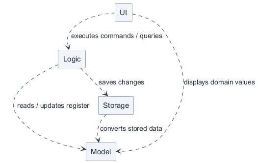
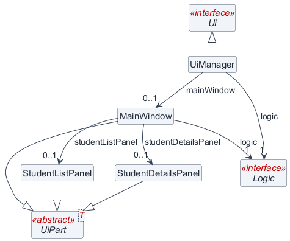
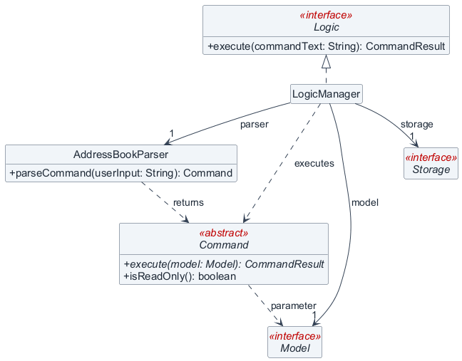
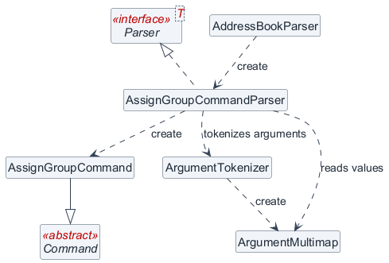
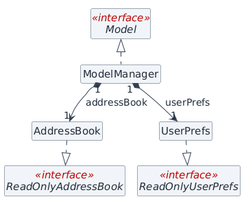
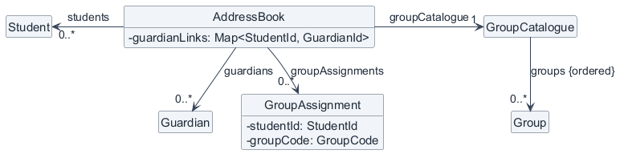
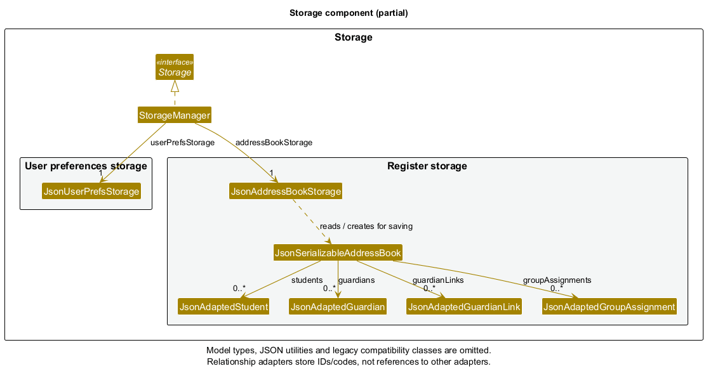
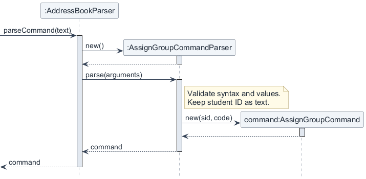
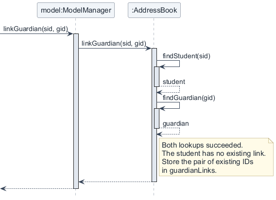
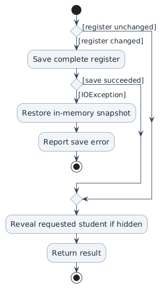

This guide describes the current Mentora source implementation: a Java desktop contact manager for a
single tuition-centre coordinator. The Java packages retain the inherited `seedu.address` name, and
`AddressBook` is the name of Mentora's register class. Neither name means that legacy AddressBook
commands are still supported.

Read the [User Guide](UserGuide.md) for command usage and the
[MVP feature specification](FeatureSpecification.md) for the product contract. Where implementation
falls short of that contract, this guide records the gap in [Known limitations](#known-limitations);
documenting a limitation does not remove the requirement. Future stories are labelled separately.

* Table of Contents
  {:toc}

## Acknowledgements

* Mentora adapts the JavaFX application structure, command architecture, tests and documentation of
  [SE-EDU AddressBook Level 3](https://github.com/se-edu/addressbook-level3).
* Runtime libraries include [OpenJFX](https://openjfx.io/) for the desktop interface and
  [Jackson](https://github.com/FasterXML/jackson) for JSON conversion. Development tools include
  [JUnit](https://junit.org/junit5/) for tests and [Gradle](https://gradle.org/) for builds.
  The exact dependency versions are declared in `build.gradle`.
* Diagrams are rendered with [PlantUML](https://plantuml.com/). Their notation follows the
  [course UML reference](https://se-education.org/se-book/uml/); the requirements format follows the
  [course requirements reference](https://se-education.org/se-book/specifyingRequirements/).

## Setting up and getting started

Follow [Setting up and getting started](SettingUp.md). Use **JDK 25** for the current source build.
From the repository root, run `./gradlew check shadowJar` on macOS/Linux or
`.\gradlew.bat check shadowJar` in Windows PowerShell. The output is
`build/libs/mentora.jar`; launch it with `java -jar mentora.jar` from the directory in which
you want Mentora to store its data. The first build needs access to dependency repositories.
Normal application use and built-in command help work offline.

## Design

### Reading the diagrams

Every diagram below has a PlantUML source in `docs/diagrams` and a rendered PNG in `docs/images`.
The class diagrams are deliberately partial: their captions state the omissions. A solid arrow
denotes a navigable association; a dashed arrow denotes a dependency; a hollow triangular arrowhead
denotes generalization (solid line) or interface realization (dashed line). A filled diamond denotes
composition. Multiplicities describe the shown association ends; an omitted multiplicity is
unspecified. Colours are decorative and do not encode extra semantics.

Sequence diagrams show synchronous calls with solid arrows, returns with dashed arrows, and
activation bars for the shown executions. Creation messages meet the newly created object's head.
No destruction marker is used merely because a Java local variable goes out of scope. See
[Maintaining the diagrams](#maintaining-the-diagrams) for rendering instructions.

### Architecture



*Figure 1. Main component dependencies. Arrows indicate use, not the direction of every data transfer. MainApp wiring and shared Commons utilities are omitted.*

| Component | Responsibility | Public interface / implementation |
| --- | --- | --- |
| UI | Accept commands; display records, feedback and help. | `Ui` / `UiManager` |
| Logic | Parse and execute commands; coordinate saving and report failures. | `Logic` / `LogicManager` |
| Model | Maintain the in-memory register, relationships, filtered views and preferences. | `Model` / `ModelManager` |
| Storage | Load and save the register and preferences as local JSON files. | `Storage` / `StorageManager` |

The UI calls Logic and displays Model value types obtained through Logic. It does not hold a
`ModelManager` or write files. Logic depends on the Model and Storage interfaces. Storage depends on
Model types to convert between JSON and domain data; Model does not depend on Storage. The
`seedu.address.commons` package supplies shared utilities, logging, exceptions and GUI settings.

`Main` launches `MainApp`. During initialization, `MainApp` loads preferences, constructs Storage,
loads the register into Model, then creates Logic and UI with their dependencies. A missing register
uses sample data; an invalid or unreadable register uses recovery mode. On normal shutdown,
`MainApp.stop()` saves preferences. Register changes are saved during command execution, not deferred
until shutdown. MainApp wiring, Commons and JavaFX infrastructure are omitted from Figure 1 to keep
the architectural view at component level.

### UI component

API: [`Ui.java`](https://github.com/AY2627S1-CS2103T-T10-4/tp/blob/master/src/main/java/seedu/address/ui/Ui.java).



*Figure 2. UI coordination and representative student panels. `UiPart` uses `T = Stage` for `MainWindow` and `T = Region` for the panels. The nullable associations account for initialization before `fillInnerParts()` installs the panels; other UI parts are omitted.*

`UiManager` creates `MainWindow`. `MainWindow` holds the shared `Logic` reference and coordinates
three workspaces: Students, Guardians and Groups. `UiPart<T>` loads JavaFX FXML; `T` is `Stage` for
windows and `Region` for the panels shown. The remaining UI parts follow the same inheritance
pattern and are listed here rather than repeating crossing inheritance lines in the diagram.

| UI part | Purpose |
| --- | --- |
| `CommandBox` | Submits text through a callback to `MainWindow.executeCommand`. |
| `ResultDisplay` | Displays success or error feedback, including multiline messages. |
| `StudentListPanel`, `StudentCard`, `StudentDetailsPanel` | Show the filtered student list, rows and the selected student's profile. |
| `GuardianListPanel`, `GuardianCard`, `GuardianDetailsPanel` | Show guardians, linked-student counts and linked-student details. |
| `GroupListPanel` | Shows the current catalogue and group selection. |
| `HelpWindow` | Shows built-in command help from `help/commands.properties`. |
| `StatusBarFooter` | Shows the data path and the session's recovery status. |

FXML layouts are in `src/main/resources/view`. For example, `MainWindow.fxml` supplies the containers
that `MainWindow.fillInnerParts()` populates. Student and guardian lists are observable; relation-only
changes also need an explicit profile refresh because they need not replace a `Student` object.

`CommandResult` carries feedback and optional UI requests. After Logic returns successfully,
`MainWindow` applies selection and workspace requests and refreshes details. On a `ParseException`
or `CommandException`, it displays the error and restores the previous student and guardian
selection where those records remain visible. See [Filtering and selection](#filtering-and-selection)
for the current navigation behaviour.

### Logic component

API: [`Logic.java`](https://github.com/AY2627S1-CS2103T-T10-4/tp/blob/master/src/main/java/seedu/address/logic/Logic.java).



*Figure 3. LogicManager retains Model, Storage and one AddressBookParser; concrete commands and parsers are shown separately. CommandResult is a returned value and does not execute UI actions.*

`LogicManager.execute(String)` asks `AddressBookParser` to route the command, executes the returned
`Command` against Model, and saves changed register data through Storage. Commands do not call
Storage or manipulate JavaFX controls. Read-only commands may change a filter or request a profile;
they do not change the persisted register. `Command.isReadOnly()` defaults to `false`.



*Figure 4. One command family: AddressBookParser creates a command-specific parser but does not implement Parser itself. Parser is shown with its generic type parameter; other parsers, prefixes and value types are omitted.*

`Parser<T>` is an interface with `T extends Command`. For example,
`AssignGroupCommandParser` implements `Parser<AssignGroupCommand>`. Its argument validation uses
`ArgumentTokenizer`, `ArgumentMultimap` and validated domain values before constructing the command.
Other command families follow this dispatch pattern, but their validation rules are specific to
their command. The old Person parsers are not routes in the current `AddressBookParser`.

### Model component

API: [`Model.java`](https://github.com/AY2627S1-CS2103T-T10-4/tp/blob/master/src/main/java/seedu/address/model/Model.java).



*Figure 5. ModelManager constructs its own AddressBook and UserPrefs from the supplied initial data. Filtered views and the register's contents are shown separately or omitted.*

`ModelManager` also holds filtered student and guardian lists backed by the register's observable
lists. These views are for browsing, while full-register lookups are authoritative for commands.
Read-only interfaces restrict the API exposed to callers; they do not imply a detached snapshot.



*Figure 6. AddressBook stores records, guardian links and group assignments. Links and assignments refer to records by ID or code; the diagram omits other fields and operations.*

`AddressBook` contains students, guardians, a `Map<StudentId, GuardianId>` of guardian links, a set
of `GroupAssignment` values and the current `GroupCatalogue`. `ModelManager.getGroupCatalogue()`
delegates to this register; ModelManager has no separate catalogue field. `ConfiguredGroups` supplies
the five defaults (`ENG`, `MAT`, `SCI`, `CHI`, `S2-MAT-A`), not a permanent restriction to those groups.

`Student`, `Guardian`, `Group`, `GroupAssignment` and `GroupCatalogue` are immutable domain classes
(not Java `record` declarations). Snapshots copy mutable collections and share immutable values, so
those values are not exclusively owned by one snapshot. A student has no guardian field: links and
assignments refer to records using IDs and group codes.
Edits replace a student or guardian while retaining its ID. `AddressBook.resetData` validates a
replacement register before publishing its contents. See [Domain invariants](#domain-invariants)
for the rules enforced by the aggregate.

### Storage component

API: [`Storage.java`](https://github.com/AY2627S1-CS2103T-T10-4/tp/blob/master/src/main/java/seedu/address/storage/Storage.java).



*Figure 7. StorageManager delegates to separate register and preference stores; the JSON wrapper composes all five adapter collections. Model types, Jackson and deserialization utilities are omitted. An absent groups property selects defaults, while an empty array means no groups.*

`JsonAddressBookStorage` uses `JsonUtil` and Jackson to read or write `JsonSerializableAddressBook`.
The wrapper converts between JSON adapters and the complete register. Relationship adapters store
IDs and codes, not copies of student or guardian records. `StoredStringDeserializer` rejects
non-string JSON values in text fields rather than allowing automatic number-to-string conversion.

| JSON collection | Adapter | Contents |
| --- | --- | --- |
| `students` | `JsonAdaptedStudent` | ID, name, academic level and optional phone. |
| `guardians` | `JsonAdaptedGuardian` | ID, name and phone. |
| `groups` | `JsonAdaptedGroup` | Code, label and kind (`Subject` or `Class`). |
| `guardianLinks` | `JsonAdaptedGuardianLink` | Student ID and guardian ID. |
| `groupAssignments` | `JsonAdaptedGroupAssignment` | Student ID and group code. |

Loading reconstructs the catalogue, students and guardians before validating assignments and links.
A conversion error prevents the partially reconstructed register from reaching Model. Missing
`students`, `guardians`, `guardianLinks` and `groupAssignments` properties default to empty
collections for compatibility. Missing `groups` uses the five defaults; an explicit empty array
means an empty catalogue. Explicitly null collections, null entries, duplicate fields, trailing JSON
content, invalid values, duplicate records and dangling references are rejected. A missing or null
student `phone` is allowed.

Unsupported fields are rejected by the register and record adapters, except the legacy root
`persons` and `_comment` fields, which are ignored. **Legacy Person data is not migrated into
Students.** An old file containing only `persons` therefore loads no students and can lose that
ignored content on the next save. Preserve a copy before attempting a migration.

The register path is `data/addressbook.json`; preferences are in `preferences.json`, both relative
to the process working directory. `MainApp` fixes these paths in the current implementation.
`StorageManager` remembers the first register-load failure and refuses later register writes for
that storage session. Preference storage is independent and can still run in recovery mode.

## Implementation

### Command routing and validation

Commands and prefixes are case-insensitive; stable ID values use uppercase `S-` or `G-` and at least
four digits. Prefix order is flexible, but a prefix cannot be repeated. Each parser rejects missing
required fields, unsupported prefixes and invalid syntax. Domain value classes validate names,
levels, phones and group values. Exact feedback comes from the relevant command/parser constants;
format errors and invalid-value errors are not necessarily the same message.



*Figure 8. Parsing `assign-group sid/S-0001 g/MAT`. The incoming call is from LogicManager; `text` is the complete input and `arguments` excludes the command word. `sid` remains validated ID text, `code` is a canonical GroupCode, and `new(...)` denotes construction. Execution and persistence occur afterwards.*

Existing-record commands retain the ID as text and resolve it in the full register. Constructing a
`StudentId` or `GuardianId` advances its generator, so lookup must not instantiate an ID just to
validate user input. New-record creation generates IDs; loading existing records advances the
generators past the numeric IDs read. IDs remain stable for a record, but are not list positions,
need not be consecutive and are not guaranteed never to be reused after deletion and restart.
The generator counters are process state and are not rolled back with a register snapshot.

### Domain invariants

| Area | Invariant and consequence |
| --- | --- |
| Student identity | IDs are unique. Normalized name plus academic level is also unique, both on addition and editing. Phone is not part of identity. |
| Guardian identity | IDs and canonical phone numbers are unique. Guardian names may repeat. A student phone may equal any other student or guardian phone. |
| Names and search | Names retain display casing. Whitespace normalization, Unicode NFKC normalization and case folding support matching. Searches use a contiguous substring of the normalized name, not separate OR keywords. |
| Academic level | `Sec 1`–`Sec 5` or `IP 1`–`IP 6`, stored canonically. Changing level does not automatically change group assignments. |
| Phone | Eight digits starting with `3`, `6`, `8` or `9`, optionally prefixed by `+65` with zero or one following space; stored as `+65 XXXXXXXX`. |
| Guardian links | A student has zero or one guardian; a guardian may have zero or many students. Both endpoints must exist. Linking twice is rejected; replacing a guardian requires unlinking first. |
| Groups | Codes are unique case-insensitively; newly configured codes have 2–20 ASCII letters, digits or hyphens, start with a letter and end with a letter or digit. Labels contain 1–80 characters after whitespace normalization. Kind is Subject or Class. |
| Assignments | Each pair of student ID and configured group code is unique and both references must exist. A student can have zero or many assignments. Class and Subject assignments are independent; class membership does not imply subject membership. |
| Student deletion | Removes that student's record, guardian link and assignments. Keeps guardians, sibling links, other assignments and configured groups. |
| Group deletion | Rejects groups with any assigned students; an unused group can be deleted. Removing an assignment never deletes its group or student. |

`AddressBook` enforces cross-record rules even when callers bypass the command layer. Model changes
that could violate an invariant are validated before mutation. `GroupCatalogue` is immutable;
adding/deleting groups replaces it and preserves catalogue order. Saving, copying, restoring and
equality checks include the catalogue, records, guardian links and assignments.

### Guardian relationships and contact updates



*Figure 9. Successful guardian linking inside Model. The command has already validated ID syntax; AddressBook checks references and the one-guardian rule. Returns abbreviate nonempty Optional values, map operations are omitted, and Logic saves afterwards.*

`LinkGuardianCommand` resolves both records and calls `Model.linkGuardian`. `ModelManager` delegates
to `AddressBook`, which rejects an existing identical link or a different guardian for that student.
`UnlinkGuardianCommand` removes only the link and returns the removed guardian ID for feedback.
Both commands request the student's profile in the Students workspace after saving succeeds.

`EditGuardianCommand` checks for another guardian with the proposed canonical phone, then replaces
the guardian with a new immutable value having the same ID and name. Student profiles resolve the
guardian through the current register, so siblings share the updated contact. MainWindow refreshes
the selected student profile, guardian details and linked-student counts after a successful command.

**Design choice:** Store one guardian record and link by ID. Copying a guardian's phone into each
student would simplify an individual display lookup but permit inconsistent sibling contacts.
The shared record requires reference validation but makes an update apply consistently.

### Group assignments and catalogue changes

`AssignGroupCommand` and `UnassignGroupCommand` resolve the student in the full register and the
group in the current catalogue. They construct `GroupAssignment` from the existing student's ID
and the canonical group's code, then call `Model.addGroupAssignment` or
`Model.removeGroupAssignment`. AddressBook validates reference existence and pair membership before
changing the set. Removing the final assignment is valid; the profile then shows `No groups assigned.`

`AddGroupCommand` adds a validated group; `DeleteGroupCommand` removes only an unused group.
These commands request the Groups workspace. New Subject groups are immediately eligible for
subject filtering. Existing catalogue data is authoritative on reload, including custom groups or
an empty catalogue.

**Design choice:** Reject deletion of an assigned group instead of cascading assignment removal.
This requires the coordinator to remove assignments explicitly but prevents an apparently small
catalogue change from discarding many students' tuition arrangements.

### Filtering and selection

Student and guardian lists are ordered by normalized name, then numeric ID. A name search replaces
that entity's current filter. `filter-students` accepts exactly one Subject group or one academic
level, replaces the current student filter and displays its description. It rejects Class groups
and combined filters. It tests explicit Subject assignments, not the subject implied by a class
code. `list-students` and `list-guardians` reset their respective filters; filters do not alter saved
records and are not persisted.

The full register remains available even when the displayed list is empty. When a successful result
requests a student hidden by the filter, `LogicManager.revealRequestedStudent` clears the student
filter after any required save. Assignment changes re-evaluate the current predicate because the
student object itself may be unchanged. MainWindow then refreshes the profile explicitly.

Workspace changes are requests in `CommandResult`, not implicit effects of every command:

| Successful command | Workspace behaviour |
| --- | --- |
| `link-guardian`, `unlink-guardian`, `assign-group`, `unassign-group`, `filter-students`, `list-students`, `find-student` | Switch to Students. |
| `list-guardians`, `find-guardian` | Switch to Guardians. |
| `list-groups`, `add-group`, `delete-group` | Switch to Groups. |
| `add-student`, `edit-student`, `view-student` | Request student selection, but keep the current workspace. |
| `delete-student`, `add-guardian`, `edit-guardian` | Keep the current workspace. |
| `help`, `exit` | Open help or close the application, respectively. |

Consequently, a student command can change the underlying Students view while another workspace
remains visible. This is a current navigation limitation, not a guarantee that all commands reveal
their result automatically. Deleting the selected student clears its selection only after successful
saving; deleting another student preserves the current selection.

### Saving, rollback and recovery



*Figure 10. Persistence after a mutating command executes successfully. Parsing, the recovery guard, snapshot creation and domain rejection precede this flow. Read-only commands bypass it, and disk rollback is not provided.*

The command boundary is:

1. Parse the input. Parse failures stop before command execution.
2. Execute read-only commands without saving. For a mutating command, first reject recovery mode.
3. Copy the complete register before executing the mutation. Commands reject invalid domain requests
   before changing the model.
4. Compare the resulting register with the snapshot. An unchanged result, such as setting the same
   phone number, does not cause a write.
5. Save a changed register once. If saving throws `IOException`, restore the in-memory snapshot and
   throw a command-specific `CommandException` retaining the original cause.
6. Only after success, reveal a requested hidden student and return the result for the UI to apply.

**Current disk-write limitation:** `FileUtil.writeToFile` writes directly to the destination.
The in-memory rollback does not undo a partial disk write and does not provide crash-safe or atomic
storage. A save error is not a guarantee that the original file is intact. Atomic replacement with
a temporary file is a required follow-up to meet NFR07 fully; it is not implemented here.

On startup there are three distinct outcomes:

| File state | Current behaviour |
| --- | --- |
| Confirmed missing path | Load no students or guardians and five default groups, with saving enabled. The register file is first written after a command changes register data. |
| Valid JSON register | Load and validate all data, then permit commands and saving. |
| Unreadable or invalid register | Preserve the input file, load an empty recovery register with default groups, display the recovery error and disable register mutations and saves for the session. |

Recovery mode still permits list, find, filter, view, help and exit commands (subject to their normal
validation and whether a target exists). The footer displays `Saving disabled`. To recover, close
Mentora, preserve the problematic file, restore a valid backup or deliberately replace it, then
restart. Editing the file while Mentora remains open does not clear the latched recovery state.
Preference errors are handled separately: defaults may be used and rewritten, so the register's
preserve-on-load-failure guarantee does not apply to `preferences.json`.

**Design choice:** Snapshot the complete register for save-error rollback. This is simple and keeps
relationships and the catalogue together, at a cost proportional to register size. Per-command
inverse operations would reduce copying but would require every mutation to implement a correct
inverse. These snapshots are temporary; they do not implement user-visible undo/redo.

### Known limitations

These are implementation gaps or release constraints, not changes to the feature specification:

* **Persistence:** partial disk writes remain possible after an I/O failure or interruption (NFR07).
  Backups and restoration are manual. The ordinary `Saved locally` footer text is static, not a
  per-command write acknowledgement; startup does not display the specification's loaded-record count.
* **Navigation:** several student commands preserve the current workspace even when they select a
  student. Guardian detail selection has no dedicated typed `view-guardian` command. Use the current
  workspace table above when testing keyboard workflows.
* **Feedback differences:** empty-value feedback can be a field-validation message instead of a
  format message. Deletion reports `Student S-9999 does not exist.` for an unknown ID and confirms
  guardian retention when the deleted student had a guardian link.
* **Long sessions:** assignment updates refresh filters by wrapping the previous predicate. Many
  repeated updates can build a deep call chain; resetting/reapplying the filter removes the chain.
  This needs a bounded refresh implementation rather than an assumption of unlimited session length.
* **Record limits:** one guardian per student; no guardian deletion, name editing, student-phone
  clearing, enrolment-status field, archiving, class filtering, combined filtering, contact-list export,
  spreadsheet import or user-visible undo/redo. Two students with the same normalized name and level
  cannot be distinguished by the current duplicate rule.
* **Compatibility:** legacy `persons` data is ignored rather than migrated. ID generation is based on
  current-process state and loaded IDs; it is not a permanent historical ID registry. Extreme numeric
  suffixes are not a supported way to extend the generator.
* **Release verification:** the build targets Java 25 and bundles JavaFX 17 platform libraries for
  Windows, macOS and Linux. Platform/CPU compatibility, timing, display scaling and keyboard acceptance
  must be checked on the intended release package; the targets below are not claims of universal testing.

### Extending the implementation

For a new command, add its command and parser, a route in `AddressBookParser`, built-in help and
tests. Mark it read-only only if it does not mutate register data. Keep reference and uniqueness
checks in the domain layer. Return UI requests through `CommandResult`; add command-specific
save-failure feedback in LogicManager when needed. For a new stored field or relationship, update
copy/reset/equality, JSON conversion, compatibility checks and round-trip tests together.

Focused handover notes remain useful for implementation history:
[student creation](feature-handover/AddStudentHandover.md),
[student editing](feature-handover/EditStudentHandover.md),
[student deletion](feature-handover/DeleteStudentHandover.md),
[guardian creation](feature-handover/AddGuardianHandover.md),
[guardian phone updates](UpdateGuardianPhoneHandover.md),
[linking](feature-handover/LinkGuardianHandover.md),
[unlinking](feature-handover/UnlinkGuardianHandover.md),
[assignment](feature-handover/AssignGroupHandover.md),
[unassignment](feature-handover/UnassignGroupHandover.md),
[group creation](feature-handover/AddGroupHandover.md),
[group deletion](feature-handover/DeleteGroupHandover.md), and
[filtering](feature-handover/FilterStudentsHandover.md).
Their release-specific plans should be read alongside the current code and feature specification.

## Documentation, logging, testing and release checks

See the [documentation guide](Documentation.md), [logging guide](Logging.md),
[testing guide](Testing.md) and [DevOps guide](DevOps.md).

The test suite covers value validation, parser rejection, domain invariants, Logic/Storage
integration and JavaFX rendering/selection. Useful regression entry points include:

| Area | Test classes |
| --- | --- |
| Complete register and relationships | `AddressBookStudentTest`, `AddressBookGuardianTest`, `AddressBookGuardianLinkTest`, `AddressBookAssignmentTest` |
| Assignment commands and saved data | `AssignGroupIntegrationTest`, `UnassignGroupIntegrationTest`, `GroupCrudIntegrationTest` |
| Guardian linking and search | `LinkGuardianIntegrationTest`, `UnlinkGuardianIntegrationTest`, `FindGuardianIntegrationTest`, `ListGuardiansLogicIntegrationTest` |
| Invalid data and failed saves | `MainAppRecoveryTest`, `LogicManagerRecoveryTest`, `JsonAddressBookStorageTest`, `JsonSerializableAddressBookTest`, `StorageManagerTest` |
| Display and selection | `MainWindowTest`, `AssignGroupUiTest`, `UnassignGroupUiTest`, `UnlinkGuardianUiTest`, `FilterStudentsUiTest`, `EditGuardianPhoneUiTest`, `HelpCommandUiTest` |

Run `./gradlew check coverage shadowJar` (Windows PowerShell: `.\gradlew.bat check coverage shadowJar`)
before a release. UI tests require a graphical display; the Linux CI job uses Xvfb. Review the Gradle
test report and coverage report, then perform the manual scenarios below on the packaged JAR.
Passing unit tests does not establish the timing, operating-system or display-scaling NFRs.

### Maintaining the diagrams

Edit the `.puml` source, then regenerate the matching PNG; do not edit only the image. The coordinated diagram update uses
`mentora-style.puml` for the ten current design diagrams; regenerate each image when its source is updated. Older AB3 tutorial/proposal assets left in
`docs/diagrams` are not current Mentora design diagrams and are not embedded here.

From the repository root, with a local PlantUML JAR, render a changed diagram using:

```text
java -jar /path/to/plantuml.jar -charset UTF-8 -failfast2 -tpng -o ../images docs/diagrams/ModelClassDiagram.puml
```

Replace the JAR path with your installation path (quote it if it contains spaces). The output
directory is relative to the source diagram's directory. Use PlantUML 1.2025.10 for consistent output. Re-render every diagram that includes
`mentora-style.puml` when changing that shared style. Inspect the generated images
at the guide's normal reading width, check links and table rendering, and preview printing before
publishing. Prefer splitting an oversized diagram to shrinking its text.

## Appendix: Requirements

### Product scope

**Target user:** A coordinator at a small private tuition centre in Singapore who manages roughly
30–200 secondary-school student records and their guardian contacts, types comfortably, and works
alone with a local desktop data set. Records may describe enrolled or prospective students, but the
current model does not store that distinction as an enrolment-status field.

**Value proposition:** Keep student details, shared guardian contacts and tuition-group assignments
together, and retrieve or update them using short typed commands.

The current product manages contact and basic administrative data. It does not manage lessons,
attendance, grades, fees, payroll or accounting, send messages, or provide multi-user synchronization.
It is not intended to replace a full school-management system. Future stories below are possible
extensions, not claims that these features are available now.

### User stories

Each row completes “As a **role**, I want to **action**, so that I can **benefit**.” Priority is
independent of implementation status: **High** means required for the current contact-management
scope, **Medium** means desirable, and **Low** means a possible later extension. The Current table
records available capabilities; any partial coverage is stated explicitly. Existing story IDs are
retained for traceability; gaps in numbering occur because future stories are in a separate table.

#### Current capabilities

| ID / priority | As a… | I want to… | So that I can… |
| --- | --- | --- | --- |
| US01 / High | new coordinator | view built-in command help and examples | learn or recall command usage while offline. |
| US02 / High | coordinator | add a student with a name and academic level | create a basic record for that learner. |
| US03 / High | coordinator | update a student's academic level | keep the record accurate after progression or correction. |
| US04 / High | coordinator | delete a student while retaining shared guardians | remove an unwanted record without disrupting siblings' contacts. |
| US05 / High | coordinator | add a guardian with a name and phone number | retain a reusable administrative contact. |
| US06 / High | coordinator | update a guardian's phone once | use the updated contact for every linked student. |
| US07 / High | coordinator | link a student to an existing guardian | find the correct responsible adult from the student's profile. |
| US08 / High | coordinator | link siblings to one guardian record | avoid maintaining duplicate copies of the same contact. |
| US09 / High | coordinator | assign a student to configured subject and class groups | record the student's tuition arrangements. |
| US10 / High | coordinator | view group assignments in a student's profile | understand that student's current tuition arrangements. |
| US11 / High | coordinator | list all registered students | browse the complete register after searching or filtering. |
| US12 / High | coordinator | search students by a whole or partial name | answer enquiries without scanning every record. |
| US13 / High | coordinator | open a student profile by stable ID | inspect the level, student phone, assignments and linked guardian together. |
| US14 / High | coordinator | perform core record tasks using typed commands | reduce repeated switching between keyboard and mouse. |
| US15 / High | coordinator | receive success feedback or an explanation of rejection | determine whether a requested change took effect and correct invalid input. |
| US16 / High | coordinator | have changed records saved locally and loaded on restart | continue work without an account or a manual save step. |
| US17 / Medium | coordinator | search guardians by name | find an existing contact before creating another record. |
| US18 / Medium | coordinator | filter students by one subject or academic level | review a relevant cohort. |
| US19 / Medium | coordinator | edit a student by ID using a command | update a record without first locating its row in a list. |
| US25 / High | coordinator | have Singapore phone formats checked before saving | correct malformed contact numbers before relying on them. |
| US31 / High | coordinator | create groups and delete unused groups | adapt the catalogue while protecting existing assignments. |
| US32 / High | coordinator | unlink an incorrectly linked guardian without deleting records | link the correct guardian afterwards. |
| US33 / High | coordinator | remove an obsolete group assignment | keep a student's tuition arrangements current. |
| US34 / High | coordinator | list configured group codes, labels and kinds | choose an unambiguous group for assignment. |
| US35 / Medium | coordinator | list guardians and inspect their linked students | reuse existing family contacts accurately. |
| US36 / High | coordinator | add or update an optional student phone independently of the guardian phone | retain a direct student contact without changing the guardian's contact. |
| US37 / High | coordinator | have invalid loaded data preserved with saving disabled | restore the original data without an empty recovery register overwriting it. |
| US38 / High | coordinator | receive duplicate-record and invalid-relationship errors | avoid conflicting contacts or references to missing records. |

US14 is only partially satisfied across workspaces: typed commands cover record mutations and
queries, but navigation and guardian-detail selection have the limitations described above. US16
does not imply atomic disk writes; NFR07 remains partially unmet. The other stories describe
capabilities, not a claim that every edge case is defect-free.

#### Future capabilities — not implemented

| ID / priority | As a… | I want to… | So that I can… |
| --- | --- | --- | --- |
| US20 / Medium | coordinator | change a prospective student's status to active | record confirmed enrolment explicitly. |
| US21 / Medium | coordinator | list only students marked active | focus daily work on enrolled learners. |
| US22 / Medium | coordinator | archive withdrawn or graduated students | retain their history outside active-student results. |
| US23 / Medium | coordinator | retrieve guardians for a selected class | identify the audience for a class announcement. |
| US24 / Medium | coordinator | copy a class contact list with each shared guardian once | prepare an external message without duplicate recipients. |
| US26 / Low | coordinator | link multiple guardians to one student | retain more than one responsible contact. |
| US27 / Low | coordinator | record a student's school | retain additional administrative context. |
| US28 / Low | coordinator | filter students by class or enrolment status | retrieve cohorts beyond the existing subject and level filters. |
| US29 / Low | coordinator | review a report of incomplete or potentially duplicate records | find data-quality issues beyond the current strict duplicate checks. |
| US30 / Low | coordinator | import and export contact lists | move data between Mentora and existing spreadsheets. |

### Use cases

For all use cases, **System:** Mentora. **Actor:** tuition-centre coordinator.
**MSS** means main success scenario. Each extension is attached to an MSS step; “ends” terminates
the current attempt and “resumes at step N” returns to that MSS step. A coordinator may abandon an
attempt; previously completed commands remain saved. Multi-command workflows are not a single
transaction. These use cases describe current capabilities, not the future stories above.

The following shared extensions apply to every use case that modifies data. They supplement the
numbered, case-specific extensions without repeating the same failure paths in each case:

* **\*a.** A request has invalid syntax, missing fields or invalid field values.
  * **\*a1.** Mentora explains the error without changing the register.
  * The use case resumes at the request step that failed.
* **\*b.** A modifying request is attempted in recovery mode.
  * **\*b1.** Mentora rejects it and explains that local data must be restored and the application restarted.
  * The use case ends.
* **\*c.** Saving a changed register fails.
  * **\*c1.** Mentora restores the in-memory state immediately before that command and reports the save failure.
  * The use case ends. Earlier successful commands remain completed. Disk contents may need restoration
    because writes are not atomic; the use case does not promise a disk rollback.

#### UC01 — Register a student with a guardian and group

**Related stories:** US02, US05, US07–US10, US13, US16, US34.

**Preconditions:** Mentora is running. The intended group is configured.

**Success postcondition:** The student and guardian exist, are linked, and the student is assigned to the group.

**MSS**

1. Coordinator requests creation of a guardian using a name and phone number.
2. Mentora creates and saves the guardian, then returns its ID.
3. Coordinator requests creation of a student using a name, academic level and optional phone.
4. Mentora creates and saves the student, then returns its ID.
5. Coordinator requests linking that student to the guardian.
6. Mentora saves the relationship and confirms it.
7. Coordinator requests assignment of the configured group to the student.
8. Mentora saves the assignment and displays the updated student profile.

The use case ends.

**Extensions**

* **1a.** The coordinator already knows the guardian's existing ID.
  * **1a1.** The coordinator reuses that ID.
  * The use case resumes at step 3.
* **2a.** The phone already belongs to a guardian.
  * **2a1.** Mentora rejects the duplicate and identifies the existing guardian.
  * **2a2.** Coordinator chooses to reuse that ID or supply a corrected phone.
  * The use case resumes at step 3 if reusing the ID, or step 1 if correcting the phone.
* **4a.** The normalized student name and level already exist.
  * **4a1.** Mentora rejects the duplicate.
  * The use case resumes at step 3. Any guardian created at step 2 remains saved.
* **6a.** A supplied ID does not identify an existing student or guardian.
  * **6a1.** Mentora reports the missing record without creating a link.
  * The use case resumes at step 5.
* **6b.** The student already has a guardian.
  * **6b1.** Mentora reports either an identical existing link or the one-guardian limit.
  * The use case ends. To replace a guardian, use UC07.
* **8a.** The student is missing, the group is not configured, or the assignment already exists.
  * **8a1.** Mentora reports the reason and does not add an assignment. An unknown-group error directs the coordinator to list groups; it does not list them automatically.
  * The use case resumes at step 7.

#### UC02 — Find a student and update the shared guardian phone

**Related stories:** US06, US12, US13, US25.

**Preconditions:** The student and linked guardian exist; the Students workspace is visible.

**Success postcondition:** The guardian has the new phone, and linked student profiles resolve that phone.

**MSS**

1. Coordinator searches for a student by name.
2. Mentora displays matching students.
3. Coordinator requests the required student's profile by ID.
4. Mentora displays the profile, including the linked guardian.
5. Coordinator requests a phone update using the guardian's ID.
6. Mentora validates and saves the update, confirms it, and refreshes the displayed contact.

The use case ends.

**Extensions**

* **2a.** No student matches.
  * **2a1.** Mentora displays an empty result and explains that no name matched.
  * The use case resumes at step 1.
* **4a.** The supplied student ID does not exist.
  * **4a1.** Mentora reports the missing student.
  * The use case resumes at step 3.
* **6a.** The guardian ID does not exist or the new phone belongs to another guardian.
  * **6a1.** Mentora rejects the update and identifies the missing ID or conflicting guardian.
  * The use case resumes at step 5.
* **6b.** The canonical phone is unchanged.
  * **6b1.** Mentora confirms the requested value without writing an unchanged register.
  * The use case ends.

#### UC03 — Review a cohort

**Related stories:** US11, US13, US18.

**Preconditions:** Mentora is running.

**Success postcondition:** The coordinator can inspect students matching one chosen criterion; stored records are unchanged.

**MSS**

1. Coordinator requests students assigned to one Subject group or at one academic level.
2. Mentora displays the matching students and the filter description in Students.
3. Coordinator requests a matching student's profile by ID.
4. Mentora displays the profile.

The use case ends.

**Extensions**

* **2a.** No students match a valid criterion.
  * **2a1.** Mentora displays an empty result and the active filter.
  * The use case ends.
* **2b.** The group is unknown, is a Class group, or the criterion is malformed or combines both filter types.
  * **2b1.** Mentora explains the error and retains the previous filter.
  * The use case resumes at step 1.
* **3a.** The coordinator requests an existing student outside the filter.
  * **3a1.** Mentora clears the filter and displays that student's profile.
  * The use case ends.
* **4a.** The student ID is missing or invalid.
  * **4a1.** Mentora reports the error and retains the previous selection.
  * The use case resumes at step 3.

#### UC04 — Find an existing guardian

**Related stories:** US17, US35.

**Preconditions:** Mentora is running.

**Success postcondition:** Matching guardian records and their IDs are available for reuse; no register data changes.

**MSS**

1. Coordinator requests guardians matching a whole or partial name.
2. Mentora opens Guardians and shows matching records with IDs, phones and linked-student counts.

The use case ends.

**Extensions**

* **1a.** The coordinator wants the complete guardian list.
  * **1a1.** Coordinator requests all guardians.
  * **1a2.** Mentora clears the guardian-name filter and displays all guardians.
  * The use case ends.
* **2a.** No guardians match, or the register has no guardians when listing all.
  * **2a1.** Mentora displays the corresponding empty-result message.
  * The use case ends.
* **2b.** The query is missing or invalid.
  * **2b1.** Mentora explains the error without replacing the existing results.
  * The use case resumes at step 1.

#### UC05 — Update a student's details

**Related stories:** US03, US19, US36.

**Preconditions:** The student exists.

**Success postcondition:** The supplied level and/or phone are updated; the student's ID, guardian link and assignments remain intact.

**MSS**

1. Coordinator requests a new academic level and/or student phone using the student's ID.
2. Mentora validates and saves the replacement student record and confirms the change.

The use case ends.

**Extensions**

* **2a.** The ID does not exist or the proposed name-and-level combination duplicates another student.
  * **2a1.** Mentora rejects the update and explains the conflict.
  * The use case resumes at step 1.
* **2b.** All supplied values already match the stored values.
  * **2b1.** Mentora confirms them without saving an unchanged register.
  * The use case ends.

#### UC06 — Delete a student

**Related stories:** US04.

**Preconditions:** The coordinator knows the ID of the student to remove.

**Success postcondition:** The student, its guardian link and its assignments are removed; guardian records and other students' data are retained.

**MSS**

1. Coordinator requests deletion of the student by ID.
2. Mentora deletes the student and its relationships, saves the result and confirms deletion.

The use case ends. There is no confirmation prompt or undo command.

**Extensions**

* **2a.** The ID does not identify an existing student.
  * **2a1.** Mentora reports the missing student without deleting anything.
  * The use case resumes at step 1.

#### UC07 — Correct a guardian relationship

**Related stories:** US07, US08, US32.

**Preconditions:** The student and intended replacement guardian exist.

**Success postcondition:** The student is linked to the intended guardian; guardian records and sibling relationships are retained.

**MSS**

1. Coordinator requests removal of the student's existing guardian link.
2. Mentora removes and saves only that relationship and confirms retention of the guardian record.
3. Coordinator requests linking the student to the intended guardian.
4. Mentora validates and saves the new relationship and displays the updated profile.

The use case ends.

**Extensions**

* **2a.** The student exists but has no guardian.
  * **2a1.** Mentora reports that there is no link to remove.
  * The use case resumes at step 3.
* **2b.** The student does not exist.
  * **2b1.** Mentora reports the missing student.
  * The use case ends.
* **4a.** An endpoint is missing or the student already has a guardian.
  * **4a1.** Mentora explains the rejection without overwriting a relationship.
  * The use case ends. A successful unlink at step 2 is not undone if this later command fails.

#### UC08 — Change a student's group assignments

**Related stories:** US09, US10, US33, US34.

**Preconditions:** The student exists. Any group to be added is configured.

**Success postcondition:** The requested assignment changes are saved; unrelated data is unchanged.

**MSS**

1. Coordinator requests removal of one obsolete assignment from the student.
2. Mentora removes and saves that assignment and confirms the change.
3. Coordinator requests assignment of the replacement group.
4. Mentora validates and saves the assignment and displays the updated profile.

The use case ends.

**Extensions**

* **1a.** The coordinator only wants to add an assignment.
  * The use case resumes at step 3.
* **2a.** The student or configured group is missing, or that pair is not assigned.
  * **2a1.** Mentora reports the reason without removing anything.
  * The use case resumes at step 1.
* **2b.** No replacement is needed, including when the final assignment was removed.
  * The use case ends after confirming the removal.
* **4a.** The student or group is missing, or the replacement pair already exists.
  * **4a1.** Mentora rejects the addition and explains the reason.
  * The use case resumes at step 3. Any removal at step 2 remains completed.

#### UC09 — Create a group

**Related stories:** US31, US34.

**Preconditions:** Mentora is running.

**Success postcondition:** The new group is configured and available for assignment.

**MSS**

1. Coordinator requests creation of a group with a code, label and kind.
2. Mentora validates and saves the new group, then displays it in Groups.

The use case ends.

**Extensions**

* **2a.** The canonical code already exists.
  * **2a1.** Mentora rejects the duplicate without changing the catalogue.
  * The use case resumes at step 1.

#### UC10 — Resume work from local storage

**Related stories:** US16, US37.

**Preconditions:** The coordinator has access to the application and its working directory.

**Success postcondition:** A valid register is available for work, loaded from storage or initialized with samples on first use.

**MSS**

1. Coordinator launches Mentora.
2. Mentora loads preferences and validates the saved register.
3. Mentora displays the loaded students and accepts commands.

The use case ends.

**Extensions**

* **2a.** The register file is missing.
  * **2a1.** Mentora uses an empty student/guardian register and the five default groups, without writing the register yet.
  * The use case resumes at step 3.
* **2b.** The register cannot be read or validated.
  * **2b1.** Mentora preserves that file, reports recovery mode and provides an empty register with default groups.
  * **2b2.** Mentora rejects modifying commands for the session while allowing read-only commands.
  * The use case ends. The coordinator can restore data while the application is closed and restart.
* **2c.** Preferences cannot be read or validated.
  * **2c1.** Mentora logs the problem, uses default preferences and attempts to save them.
  * The use case continues with register loading at step 2; this alone does not enable register recovery mode.

#### UC11 — Consult command help

**Related stories:** US01, US15.

**Preconditions:** Mentora is running.

**Success postcondition:** The coordinator can read help without a network connection.

**MSS**

1. Coordinator requests help for a supported command.
2. Mentora displays its syntax, examples, validation rules and common errors.

The use case ends.

**Extensions**

* **1a.** No command name is supplied.
  * **1a1.** Mentora displays the command overview.
  * The use case ends.
* **2a.** The command is unknown, or more than one command word is supplied.
  * **2a1.** Mentora reports the unsupported topic or required format.
  * The use case resumes at step 1.

#### UC12 — Delete an unused group

**Related stories:** US31, US34.

**Preconditions:** Mentora is running and the coordinator knows the intended group code.

**Success postcondition:** The group is removed; records and other groups are unchanged.

**MSS**

1. Coordinator requests deletion of a group by code.
2. Mentora verifies that the group exists and has no assigned students, deletes and saves it, and confirms deletion.

The use case ends. There is no confirmation prompt or undo command.

**Extensions**

* **2a.** The group does not exist.
  * **2a1.** Mentora reports the unknown group and suggests listing configured groups.
  * The use case resumes at step 1.
* **2b.** Students are assigned to the group.
  * **2b1.** Mentora rejects deletion and reports the assignment count.
  * The use case ends. The coordinator can remove assignments using UC08 before trying again.

#### UC13 — Browse configured groups

**Related stories:** US34.

**Preconditions:** Mentora is running.

**Success postcondition:** The current catalogue is visible; stored data is unchanged.

**MSS**

1. Coordinator requests the configured groups.
2. Mentora displays each group's code, label and kind in Groups and reports the count.

The use case ends. An empty catalogue is a valid result with a count of zero.

**Extensions**

* **2a.** The request contains unexpected arguments.
  * **2a1.** Mentora reports the required format and leaves the existing workspace unchanged.
  * The use case resumes at step 1.

### Non-functional requirements

These are acceptance targets and constraints. **Pending verification** means the stated measurement
has not been established by this documentation review. **Partial** means an identified implementation
gap remains; it is not an exemption. The single-user/local-data scope is a product constraint rather
than a claim that concurrent writers are safely coordinated.

1. **NFR01 — Platform compatibility.** The packaged application must launch and complete the core
   manual scenarios on Windows, macOS and Linux with Java 25 and compatible JavaFX native libraries.
   Record the OS version and CPU architecture for each release check; do not infer ARM support from
   an x86-64 build. **Status:** cross-platform release verification pending; the build currently
   specifies JavaFX `win`, `mac` and `linux` classifiers.
2. **NFR02 — Portable distribution.** With the required Java runtime installed, the user must be
   able to run the release JAR from a writable directory without installing Mentora or a separate
   database. Verify a fresh-directory launch using `java -jar mentora.jar`. **Status:** packaging
   supported by `shadowJar`; test each final release artifact.
3. **NFR03 — Offline operation.** After obtaining the JAR and Java runtime, all current record
   commands, reload and built-in help must work with network access disabled and without an account
   or remote service. Optional external documentation links and build-time downloads are excluded.
   **Status:** locally implemented; offline packaged acceptance check required.
4. **NFR04 — Inspectable storage.** The complete register and preferences must be stored as local
   UTF-8 JSON readable by a text editor. A valid save/reload must preserve every domain value and
   relationship, including custom groups and optional student phones. **Status:** implemented with
   JSON conversion and round-trip tests; manual file changes require closing the application first.
5. **NFR05 — Capacity and command latency.** For 200 students, up to 200 guardians, 50 groups, at most
   one guardian link and ten group assignments per student, a valid command must display its result
   within one second on a reference computer with a 2 GHz four-core CPU, 8 GB RAM, an SSD and Java 25.
   Measure from command submission to displayed result, including any save; exclude time spent typing
   and OS start-up. Run 30 trials per command family after warm-up and record the maximum, including
   worst-size lists and searches. **Status:** benchmark pending; this is a target, not a measured claim.
6. **NFR06 — Startup latency.** With the NFR05 data set on the same reference computer, the application
   must reach a visible, command-ready window within three seconds of process launch. Measure ten
   launches and record the maximum and cache conditions; do not count Java installation or first-time
   dependency downloads. **Status:** benchmark pending.
7. **NFR07 — Data integrity.** A failed state-changing command must leave the pre-command in-memory
   register intact, and saving must either replace the entire persistent register or leave its previous
   contents intact. An invalid or unreadable register must not be overwritten by recovery-mode saves.
   Verify using injected write failures, interrupted-write tests and invalid-file startup tests.
   **Status: partial.** In-memory rollback on `IOException` and load-failure protection exist, but
   direct disk writes do not meet atomicity or interruption safety. The contract is retained.
8. **NFR08 — Keyboard accessibility.** A user must be able to create, retrieve, update, link/unlink,
   assign/unassign and delete supported records, obtain help and exit without mouse input, starting
   from any workspace. Verify the complete command workflow, focus movement and result visibility.
   **Status: partial.** Commands exist, but cross-workspace result visibility and guardian-detail
   selection need further work and keyboard acceptance testing.
9. **NFR09 — Display compatibility.** At 1920×1080 and above with 100% or 125% scaling, text and controls
   must remain readable; at 1280×720 with 150% scaling every function and complete result must remain
   reachable without controls falling off-screen. Test long names, multiline errors, many assignments
   and help content at these settings. **Status:** verification pending with a known risk: MainWindow
   initially requests at least 900×600 logical units, while 1280×720 at 150% offers less logical space.
10. **NFR10 — Distribution size.** Each distributed JAR or ZIP must be no larger than 100 MB
    (100,000,000 bytes). Measure the final artifact, including bundled native libraries and assets.
    **Status:** check the release artifact; source-directory size is not the metric.
11. **NFR11 — Dependency distribution.** Bundled third-party libraries must be available without
    additional user payment, carry redistribution-compatible open-source licences with the required
    notices, and require no separate end-user installation beyond the declared Java prerequisite.
    Check the final dependency list and notices for each release. **Status:** audit required; a blanket
    “all libraries are permissively licensed” claim is inappropriate for the JavaFX dependency.
12. **NFR12 — Maintainability.** The application must remain a Java implementation with distinct UI,
    Logic, Model and Storage responsibilities. Domain invariants must be testable without starting
    JavaFX UI controls, and command parsers must be testable without writing user files. Verify through
    dependency review and the domain/parser test suites. **Status:** reflected in the current structure.

### Glossary

| Term | Meaning in Mentora |
| --- | --- |
| Academic level | A student's canonical level: Sec 1–5 or IP 1–6. It is independent of group assignments. |
| Assignment | A unique pair of student ID and group code recording group membership. |
| Canonical value | A standard stored/comparison representation, such as `+65 91234567` or uppercase group code `MAT`. |
| Class group | A configured tuition class, for example `S2-MAT-A`; assigning it does not automatically assign its Subject group. |
| Coordinator | The single local user maintaining the tuition centre's register. |
| Group catalogue | The ordered set of currently configured Subject and Class groups, including user-created groups. |
| Guardian | A parent or other responsible contact whose canonical phone is unique among guardian records; it may exist without linked students. A student's separate phone may use the same number. |
| Guardian link | A relationship from one student ID to one guardian ID; at most one per student. |
| Immutable value | A value whose fields do not change after construction; an edit uses a replacement value. |
| Normalized name | The comparison form of a validated name after whitespace, Unicode and case normalization. |
| Read-only command | A command that leaves persisted register data unchanged, although it may alter a filter, selection, workspace or help display. |
| Recovery mode | A session entered after a register-load failure; register writes and modifying commands are disabled. |
| Register / aggregate | The complete AddressBook data: students, guardians, catalogue, links and assignments. |
| Shared guardian | One guardian record linked to multiple students, such as siblings. |
| Stable ID | An immutable identifier for an existing student or guardian, independent of list position; not a promise of never reusing deleted IDs across restarts. |
| Student | A learner represented by a name, level, generated ID and optional phone. The current model has no enrolment-status field. |
| Subject group | A configured subject such as Mathematics; explicit membership can be used by `filter-students`. |
| Workspace | One of the Students, Guardians or Groups views inside the main window. |

For planned features only, **enrolment status** distinguishes prospective, active, withdrawn and
graduated students; an **archived student** is retained outside active lists; a **class contact list**
is a deduplicated collection of guardian contacts for external use. These concepts have no current
domain field or command.

## Appendix: Instructions for manual testing

These repeatable checks use synthetic records and describe current source-build behavior, with version dependencies noted below. Record the exact source revision or release, JAR filename, Java version, operating system, actual results and any deviations. When testing a historical release, verify its behavior before applying the exact expectations below. Run the workflow sections in order; the startup/recovery scenarios use separate folders. These checks are a starting point for further exploratory testing, not a claim of exhaustive coverage.

### Setup and test conventions

1. Run `java -version` in a terminal and confirm Java **25**. Obtain a JAR from the [team releases](https://github.com/AY2627S1-CS2103T-T10-4/tp/releases), or run `./gradlew shadowJar` (`.\gradlew.bat shadowJar` on Windows) in a source checkout.
   Current source builds produce `build/libs/mentora.jar`. The historical v1.4.1 release asset was named `Mentora.jar`. When testing a historical release, use its actual JAR filename and capitalization.
2. Create a new writable folder named `workflow` in a disposable test location and copy the JAR into it. Keep it separate from personal data and other running Mentora instances.
3. Before launching, create `workflow/data/addressbook.json` as a UTF-8 text file containing exactly `{"students":[]}`. This valid empty register gives no students or guardians and the five default groups. A zero-byte file is **not** a valid empty register.
4. Open a terminal **inside `workflow`** and run `java -jar "mentora.jar"` for the current source build. When testing a historical release, substitute its actual JAR filename. Mentora uses `data/addressbook.json` relative to this working folder; its location appears in the footer. Select **Students**.
5. Submit one command at a time. Record the IDs returned when adding Amy, Ben and Anita as **`SID_A`**, **`SID_B`** and **`GID`**. Replace these tokens in every later command and expected message with the actual IDs, including their `S-` or `G-` prefix. They are not literal input, list positions or assumed consecutive numbers. Student IDs also appear in Students; use `list-guardians` to recover a guardian ID.
6. For every rejection below, check the exact feedback and that records, displayed lists, filters, selection and details remain unchanged from immediately before that command. Once a data file exists, its contents should also be unchanged. Each invalid-input case keeps the other required values valid.
7. To repeat a workflow section, close Mentora, create another disposable folder with the empty-register fixture, and repeat its preceding setup steps. Do not reset by deleting files in a normal installation. Cleanup means closing only the test instance and retaining or discarding only its disposable folder.

For command syntax and field rules, see the [User Guide](UserGuide.md) or `help COMMAND`. Counted results below depend on the stated fixture and sequence. Successful edits save immediately; listing, finding, filtering and viewing do not save.

Successful `list-students` and `find-student` open Students, including empty results. `view-student` retains the active workspace; select Students to inspect its requested profile. Run the additional focused checks below in their own disposable folders; they must not alter the main workflow or its `valid-register.json` backup.

### Students: create, retrieve and update

**Starting state:** the empty `workflow` fixture above, with Students selected. Keep both created students for the following sections.

| Command/action | Expected feedback | Expected visible state |
| --- | --- | --- |
| Select Groups; `list-students` | `No students registered.` | Students opens with an empty list. |
| `add-student n/Amy Tan al/Sec 2 p/91234567` | `Added student SID_A: Amy Tan (Sec 2) with phone +65 91234567.` | Amy is selected; profile shows Sec 2, the student phone, `Guardian: none` and `No groups assigned.` Record `SID_A`. |
| `add-student n/Ben Tan al/IP 4` | `Added student SID_B: Ben Tan (IP 4).` | Ben is selected; profile shows IP 4 and `Phone: none`. Record `SID_B`. |
| Select Groups; `list-students` | `Listed 2 student(s).` | Students opens; Amy and Ben appear, in name order, with their stable IDs and levels. Ben remains selected. |
| `add-student n/Amy Tan al/Sec 2` | `A student named Amy Tan at Sec 2 already exists.` | No third student; Ben remains selected. |
| `add-student n/Cara Lim` | `Invalid command format. Use: add-student n/NAME al/ACADEMIC_LEVEL [p/PHONE]` | No Cara record. The missing level is the invalid condition. |
| Select Guardians; `find-student n/amy` | `Found 1 student matching "amy".` | Students opens with only Amy listed; the hidden Ben selection is cleared. |
| Select Groups; `find-student n/Zzz` | `No students match "Zzz".` | Students opens with an empty displayed list; both records are still stored. |
| Select Groups; `view-student sid/SID_A`; then select Students | `Opened profile for SID_A.` | The command leaves Groups active until you select Students. The hiding filter clears; both rows return and Amy is selected. Heading shows `SID_A - Amy Tan`. |
| `filter-students al/Sec 2` | `Found 1 student(s) at Sec 2.` | Students opens, showing only Amy and `Filtered by academic level: Sec 2`. |
| `edit-student sid/SID_A al/Sec 3 p/98765432` | `Updated student SID_A: academic level is now Sec 3 and phone is now +65 98765432.` | Same Amy ID/name; both fields update. The Sec 2 filter clears to reveal Amy, and both rows are visible. |

**Boundary and invalid-value checks:** continue with Amy selected. Run each command separately; these check phone lengths just below/at/above eight digits and the Sec-level endpoints. Ben must remain unchanged.

| Command/action | Expected feedback and state |
| --- | --- |
| `edit-student sid/SID_A p/9123456` | `Phone number must be an 8-digit Singapore number, optionally prefixed by +65.` Amy retains `+65 98765432`. |
| `edit-student sid/SID_A p/91234567` | `Updated student SID_A phone to +65 91234567.` Only the student phone changes. |
| `edit-student sid/SID_A p/912345678` | Same phone-validation error; Amy retains `+65 91234567`. |
| `edit-student sid/SID_A al/Sec 0` | `Academic level must be Sec 1-5 or IP 1-6.` Amy remains Sec 3. |
| `edit-student sid/SID_A al/Sec 1`, then `edit-student sid/SID_A al/Sec 4`, then `edit-student sid/SID_A al/Sec 5` | Each succeeds: `Updated student SID_A: academic level is now Sec LEVEL.` Replace `LEVEL` with 1, 4 or 5 respectively; verify the selected profile each time. |
| `edit-student sid/SID_A al/Sec 6` | Same academic-level error; Amy remains Sec 5. |
| Reset: `edit-student sid/SID_A al/Sec 3 p/98765432` | `Updated student SID_A: academic level is now Sec 3 and phone is now +65 98765432.` Continue with these values. |

### Guardians: shared contact and phone updates

**Starting state:** Amy and Ben from the student checks; no guardians or links. Student phones and guardian phones are separate fields.

| Command/action | Expected feedback | Expected visible state |
| --- | --- | --- |
| `list-guardians` | `No guardians registered.` | Guardians opens with an empty list. |
| `add-guardian n/Anita Lim p/92345678` | `Added guardian GID: Anita Lim (+65 92345678).` | One guardian is added. Record `GID`; creation alone does not promise selection. |
| `list-guardians`, then click the row with `GID` | `Listed 1 guardian(s).` | Anita has phone `+65 92345678` and no linked students. |
| `find-guardian n/anita` | `Found 1 guardian matching "anita".` | Anita is the only matching guardian. |
| `add-guardian n/Other Guardian p/+6592345678` | `A guardian with phone +65 92345678 already exists (GID). Link that guardian instead.` | Normalized duplicate phone is rejected; one guardian remains. |
| `link-guardian sid/SID_A gid/GID` | `Linked student SID_A (Amy Tan) to guardian GID (Anita Lim, +65 92345678).` | Students opens and Amy is selected; her profile displays Anita and the guardian phone. |
| `link-guardian sid/SID_B gid/GID` | `Linked student SID_B (Ben Tan) to guardian GID (Anita Lim, +65 92345678).` | Ben is selected with the same guardian. |
| Repeat `link-guardian sid/SID_B gid/GID` | `Student SID_B is already linked to guardian GID.` | No duplicate relationship. |
| `list-guardians`, then select `GID` | `Listed 1 guardian(s).` | Linked-student count is 2; details list Amy and Ben with their recorded IDs. |
| Select Students; `view-student sid/SID_A`, then `edit-guardian gid/GID p/+65 93456789` | `Opened profile for SID_A.`, then `Updated guardian GID phone to +65 93456789. Updated contact will appear in 2 linked student profile(s).` | Amy stays selected; her guardian contact updates immediately, while her own phone remains `+65 98765432`. |
| `view-student sid/SID_B` | `Opened profile for SID_B.` | Ben also shows Anita with `+65 93456789`, while his student phone remains absent. |

Keep both links for the save/reload and unlink checks below.

### Groups: catalogue, assignments and filtering

**Starting state:** both students and their shared guardian remain. The fixture catalogue has only `ENG`, `MAT`, `SCI`, `CHI` and `S2-MAT-A`; neither `PHY` nor `S3-PHY-B` exists.

| Command/action | Expected feedback | Expected visible state |
| --- | --- | --- |
| `list-groups` | `Listed 5 configured group(s).` | Groups opens; each default row shows its code, label and kind. |
| `add-group g/PHY l/Physics k/Subject` | `Created group PHY (Physics, Subject).` | Groups selects PHY. |
| `add-group g/S3-PHY-B l/Secondary 3 Physics B k/Class` | `Created group S3-PHY-B (Secondary 3 Physics B, Class).` | Groups selects S3-PHY-B. |
| `add-group g/phy l/Other Physics k/Subject` | `Group PHY is already configured.` | No duplicate, renamed label or extra group; `list-groups` reports `Listed 7 configured group(s).` |
| `assign-group sid/SID_A g/PHY` | `Assigned group PHY (Physics) to student SID_A.` | Students opens; Amy is selected and her profile lists PHY / Physics. |
| `assign-group sid/SID_B g/S3-PHY-B` | `Assigned group S3-PHY-B (Secondary 3 Physics B) to student SID_B.` | Ben is selected and shows the Class assignment; his IP 4 level is unchanged. |
| `filter-students g/PHY` | `Found 1 student(s) assigned to PHY.` | Only Amy is listed; summary is `Filtered by group: PHY — Physics`. |
| `filter-students g/S3-PHY-B` | `Group S3-PHY-B is a Class group; use the academic-level filter.` | The previous PHY filter/results remain. |
| `filter-students g/PHY al/Sec 3` | `Invalid command format. Use: filter-students g/GROUP_CODE` | Two individually valid criteria cannot be combined; previous results remain. |
| `view-student sid/SID_B` | `Opened profile for SID_B.` | Hidden Ben is revealed and selected; both students return and the filter clears. |
| `delete-group g/PHY` | `Group PHY is assigned to 1 student(s). Remove those assignments before deleting it.` | Group and Amy’s assignment remain; Ben’s selection/details are unchanged. |

### Save and reload the completed workflow

**Starting state:** exactly two students, one guardian, seven groups; Amy has PHY and Ben has S3-PHY-B; both link to Anita.

1. Run `exit`. The application closes (the command feedback is `Closing Mentora.`). Reopen the **same JAR from the same `workflow` folder**.
2. Select Students and run `list-students`: expect `Listed 2 student(s).`. Run `view-student sid/SID_A`: expect `Opened profile for SID_A.` and Amy’s Sec 3, student phone `+65 98765432`, PHY assignment and Anita’s `+65 93456789` contact.
3. Run `view-student sid/SID_B`: expect `Opened profile for SID_B.`, IP 4, `Phone: none`, S3-PHY-B and the same guardian contact. IDs must match those recorded before restart.
4. Run `list-guardians`: expect `Listed 1 guardian(s).`; select `GID` and check both linked students. Run `list-groups`: expect `Listed 7 configured group(s).` including both newly created groups.
5. Close Mentora with `exit`. Copy this **test** `data/addressbook.json` to a file named `valid-register.json` outside the `workflow` folder but inside the disposable test location. Keep it for the recovery scenario. Relaunch the workflow folder before continuing.

### Unlink, unassign and delete safely

**Starting state:** the saved workflow above. These destructive commands affect only synthetic records.

| Command/action | Expected feedback | Expected visible state |
| --- | --- | --- |
| Select Students; `unlink-guardian sid/SID_A` | `Removed guardian GID from student SID_A. Guardian record was retained.` | Amy is selected and shows `Guardian: none`; her PHY assignment remains. |
| Repeat `unlink-guardian sid/SID_A` | `Student SID_A has no guardian to unlink.` | Amy and Anita both remain. |
| `list-guardians`, then select `GID` | `Listed 1 guardian(s).` | Only Ben is linked; linked-student count is 1. |
| `link-guardian sid/SID_A gid/GID` | `Linked student SID_A (Amy Tan) to guardian GID (Anita Lim, +65 93456789).` | Amy is selected; both students again share Anita. |
| `unassign-group sid/SID_A g/PHY` | `Removed group PHY from student SID_A.` | Amy shows `No groups assigned.`; guardian and other student fields remain. |
| `delete-group g/PHY` | `Deleted group PHY: Physics (Subject).` | Groups opens; PHY is absent and the other six groups remain. |
| Repeat `delete-group g/PHY` | `Group PHY is not configured. Run list-groups to see available groups.` | Unknown-code rejection changes no remaining group. |
| `assign-group sid/SID_A g/MAT` | `Assigned group MAT (Mathematics) to student SID_A.` | Amy is selected and has an assignment for the deletion check. |
| `delete-student sid/SID_A` | `Deleted student SID_A: Amy Tan. Guardian link removed; guardian GID was retained.` | Amy disappears and her selected profile clears. Her assignment/link are removed; Ben remains. |
| `view-student sid/SID_A` | `Student SID_A does not exist.` | The previously generated, now-deleted ID is a reliable unknown-ID case. No record reappears. |
| `view-student sid/SID_B` | `Opened profile for SID_B.` | Ben retains his ID, IP 4, Class assignment and Anita link. |
| `list-guardians`, then select `GID`; `list-groups` | `Listed 1 guardian(s).`, then `Listed 6 configured group(s).` | Anita is retained with only Ben linked; MAT is still configured. |
| `unassign-group sid/SID_B g/S3-PHY-B`, then `delete-group g/S3-PHY-B` | `Removed group S3-PHY-B from student SID_B.`, then `Deleted group S3-PHY-B: Secondary 3 Physics B (Class).` | Ben’s final assignment is removed; five default groups remain. |

**Cleanup:** close the test instance. To rerun, use a new folder and fresh IDs; guardian deletion is not supported, so do not invent a cleanup command.

### Missing data file: normal startup

**Starting state:** create a separate new folder named `missing` containing only the JAR. Do not copy preferences or a `data` directory into it.

1. Launch from `missing` using the actual JAR filename. Students and Guardians are empty and the five default groups are available; no recovery warning or `Saving disabled` indicator appears.
2. Run `list-students`: expect `No students registered.` The register file must still be absent after startup and this read-only command; preferences/log files may exist.
3. Run `add-student n/Recovery Check al/Sec 2`. Record its generated ID as `SID_C`; expect `Added student SID_C: Recovery Check (Sec 2).` The new student is selected and `data/addressbook.json` now exists.
4. Exit and relaunch from `missing`; `list-students` reports `Listed 1 student(s).`. `view-student sid/SID_C` reports `Opened profile for SID_C.` and displays the saved student.

Close this test instance when finished. Missing-file startup is normal and must not be confused with invalid-file recovery.

### Invalid data file: preservation and recovery

**Starting state:** the valid synthetic backup from the save/reload section is available. Create a third disposable folder named `recovery`, copy the JAR into it, and ensure no Mentora instance is using it.

1. Create `recovery/data/addressbook.json` as UTF-8 text containing exactly `broken JSON`. Keep an identical copy named `invalid-original.json` outside its `data` directory. This deliberately malformed file must never replace personal data.
2. Record its SHA-256 hash. On Windows PowerShell, from `recovery`, run `Get-FileHash -LiteralPath .\data\addressbook.json -Algorithm SHA256`; on macOS/Linux use an equivalent checksum tool. Launch the JAR from `recovery`.
3. Expect empty student/guardian lists and this recovery feedback: **`Could not load local data. Your original data file was not changed; restore or replace it before saving.`** The footer must say **`Saving disabled`**; hovering over it explains the failure.
4. Run `list-students` and `list-guardians`: expect `No students registered.` and `No guardians registered.` respectively. Run `list-groups`: expect `Listed 5 configured group(s).`. Read-only feedback may replace the warning text, but the footer must remain `Saving disabled`. Each list command opens its corresponding workspace.
5. Run the syntactically valid mutation `add-student n/Recovery Check al/Sec 2`. Expect the same recovery message from step 3; no student is added and saving stays disabled. A malformed command would test parsing instead, so use this exact valid input.
6. Run `exit`, then recompute the register hash and compare it with step 2 (or compare the bytes with `invalid-original.json`). They must match. Recovery does not repair or back up the register automatically; preferences and logs can change independently.
7. With Mentora closed, retain the invalid copy and replace only the disposable `recovery/data/addressbook.json` with the saved `valid-register.json`. Relaunch. Expect the two students, guardian links and seven groups from that backup, with no recovery warning or `Saving disabled` indicator. Saving remains disabled for an old recovery session even if its file is replaced externally; a restart is required.
8. Select Students and run `edit-student sid/SID_B p/94567890`: expect `Updated student SID_B phone to +65 94567890.` and the phone in Ben’s profile. Exit, reopen, and use `view-student sid/SID_B` to confirm the saved phone and original relationships.

**Cleanup:** close the test instance and keep the test files/results for review, or discard only the disposable test location. File preservation in this scenario concerns load-failure recovery; it does not imply that normal saves use atomic file replacement.

### Additional focused checks: isolated edge cases

**Starting state:** create a new disposable folder named `edge-cases`, separate from `workflow`, `missing` and `recovery`. Copy the same JAR into it and, with Mentora closed, create `edge-cases/data/addressbook.json` containing exactly `{"students":[]}`. Launch from `edge-cases` with `java -jar "mentora.jar"` and select Students. Do not copy or modify the main workflow's `valid-register.json`.

Run the four setup commands below once. Record their generated IDs as `EX_A`, `EX_B`, `EX_G1` and `EX_G2`, and substitute them everywhere in this section. The two students deliberately have the same name at different levels; distinguish them by ID. Failed additions may consume an ID, so do not assume consecutive IDs.

| Setup command | Expected feedback and state |
| --- | --- |
| `ADD-STUDENT AL/sec 2 N/Noor Tan P/91234567` | `Added student EX_A: Noor Tan (Sec 2) with phone +65 91234567.` The uppercase command/prefixes and alternate field order are accepted; Noor at Sec 2 is selected. |
| `add-student n/Noor Tan al/Sec 4` | `Added student EX_B: Noor Tan (Sec 4).` A different level is permitted; EX_B is selected with `Phone: none`. |
| `add-guardian n/Alice Tan p/81234567` | `Added guardian EX_G1: Alice Tan (+65 81234567).` |
| `add-guardian n/Ben Tan p/87654321` | `Added guardian EX_G2: Ben Tan (+65 87654321).` |

There are now exactly two students, two guardians, five default groups and no links or assignments. Continue in the order below. For each rejection, compare the existing data file's bytes before and after the command and check that the prior tab, filter, selection and relationships remain unchanged.

| Command/action | Expected feedback | Expected visible state |
| --- | --- | --- |
| `add-student n/  noor   tan  al/sec 2` | `A student named noor tan at Sec 2 already exists.` | Case and repeated spaces normalize to EX_A's identity. The feedback uses the supplied cleaned lowercase name; two students remain and EX_B stays selected. |
| `edit-student sid/EX_A al/Sec 4` | `Cannot update EX_A: a student named Noor Tan at Sec 4 already exists.` | EX_A remains Sec 2; EX_B remains Sec 4. The failed edit does not select EX_A. |
| `link-guardian sid/EX_A gid/EX_G1` | `Linked student EX_A (Noor Tan) to guardian EX_G1 (Alice Tan, +65 81234567).` | Students opens; EX_A is selected with Alice's contact. |
| `link-guardian sid/EX_A gid/EX_G2` | `Student EX_A already has guardian EX_G1. Unlink it before linking another guardian.` | EX_A keeps Alice; no relationship is overwritten. |
| `edit-guardian gid/EX_G1 p/87654321` | `Phone +65 87654321 is already used by guardian EX_G2.` | Alice retains `+65 81234567`; guardian Ben retains `+65 87654321`. |
| `link-guardian sid/EX_B gid/EX_G2` | `Linked student EX_B (Noor Tan) to guardian EX_G2 (Ben Tan, +65 87654321).` | EX_B is selected with guardian Ben's contact. |
| `assign-group sid/EX_A g/S2-MAT-A` | `Assigned group S2-MAT-A (Secondary 2 Mathematics A) to student EX_A.` | EX_A is selected and has only the Class assignment; no Subject membership is inferred. |
| `filter-students g/MAT` | `No students are assigned to MAT.` | Empty Students view, although EX_A belongs to the Mathematics Class. Both student records remain stored. |
| `view-student sid/EX_A` | `Opened profile for EX_A.` | Both rows return; EX_A is selected with only S2-MAT-A. |
| `assign-group sid/EX_A g/mat` | `Assigned group MAT (Mathematics) to student EX_A.` | EX_A now has two distinct assignments, MAT and S2-MAT-A. |
| Repeat `assign-group sid/EX_A g/MAT` | `Student EX_A is already assigned to MAT.` | Exactly two assignments remain on EX_A; no duplicate pair. |
| `unassign-group sid/EX_A g/MAT` | `Removed group MAT from student EX_A.` | S2-MAT-A remains on EX_A; the Class and Subject assignments are independent. |
| `assign-group sid/EX_B g/MAT` | `Assigned group MAT (Mathematics) to student EX_B.` | EX_B is selected with MAT only; no Class assignment is inferred, and Sec 4 is unchanged. |
| Choose `G_MISSING` as an uppercase ID of the form `G-` followed by at least four digits, different from both recorded guardian IDs. For example, use `G-999999` only after confirming it is neither EX_G1 nor EX_G2. Run `link-guardian sid/EX_A gid/G_MISSING`. | `Guardian G_MISSING does not exist.` | EX_B stays selected; both existing links and phones remain. This is a syntactically valid missing reference, not an ID-format test. |
| `view-student sid/EX_A`, then `delete-student sid/EX_B` | `Opened profile for EX_A.`, then `Deleted student EX_B: Noor Tan. Guardian link removed; guardian EX_G2 was retained.` | EX_A remains selected with Sec 2, `+65 91234567`, Alice and S2-MAT-A. EX_B and its MAT assignment/link disappear; its guardian remains. |
| `list-guardians`, then select EX_G2 | `Listed 2 guardian(s).` | Guardian Ben has zero linked students; Alice has one. Only EX_A remains in the register, and the five default groups remain configured. |

#### Help and current exit handling

Keep the same disposable `edge-cases` instance. Close the help window after each successful help request before entering the next command in the main window.

| Command/action | Expected feedback and outcome |
| --- | --- |
| `help` | `Opened help window.` The command overview opens; records and the current workspace are unchanged. |
| `help add-student` | `Showing help for add-student.` The help window shows that command's syntax and examples; no student is added. |
| `help unknown-command` | `No help is available for "unknown-command". Run help to see all commands.` No data changes. |
| `help add-student extra` | `Invalid command format. Use: help [COMMAND]` No data changes. |
| With the help window closed, `exit extra` | `Invalid command format. Use: exit` The application remains open and data is unchanged. |
| `exit` | `Closing Mentora.` The application closes. |

**Cleanup:** close only the edge-case instance. Keep its evidence separately from the main workflow. To repeat, start again in a new disposable folder with the explicit empty-register fixture and fresh generated IDs.

### Additional focused checks: absent versus empty group catalogue

These cases use valid data files, not the missing-file or malformed-file startup paths. Create two separate new disposable folders, `catalogue-defaults` and `catalogue-empty`, each with the same JAR and its own `data` directory. With no instance running in either folder, write the exact UTF-8 JSON below.

| Folder and data-file contents | Commands/actions | Expected feedback and state |
| --- | --- | --- |
| `catalogue-defaults/data/addressbook.json` contains `{"students":[]}`. | Launch from `catalogue-defaults` with `java -jar "mentora.jar"`; run `list-students`, then `list-groups`. | `No students registered.`, then `Listed 5 configured group(s).` Groups shows ENG, MAT, SCI, CHI and S2-MAT-A. No sample students or recovery warning appear. The absent `groups` property supplies defaults. |
| `catalogue-empty/data/addressbook.json` contains `{"students":[],"groups":[]}`. | Launch from `catalogue-empty` with `java -jar "mentora.jar"`; run `list-students`, then `list-groups`. | `No students registered.`, then `Listed 0 configured group(s).` Groups shows `No configured groups.` The explicitly empty catalogue is retained; no recovery warning appears. |
| Continue in `catalogue-empty` with Groups active. | `filter-students g/MAT` | `Group MAT is not configured. Run list-groups to see available groups.` Groups remains active and empty; the file is unchanged. Defaults are not silently reintroduced. |
| Continue in `catalogue-empty`. | `exit`; relaunch the same JAR from the same folder; run `list-groups`. | `Listed 0 configured group(s).` The empty catalogue survives restart without entering recovery. |

**Cleanup:** close both test instances. Preserve or discard only these disposable directories. Do not replace the main workflow's backup or any personal register.
