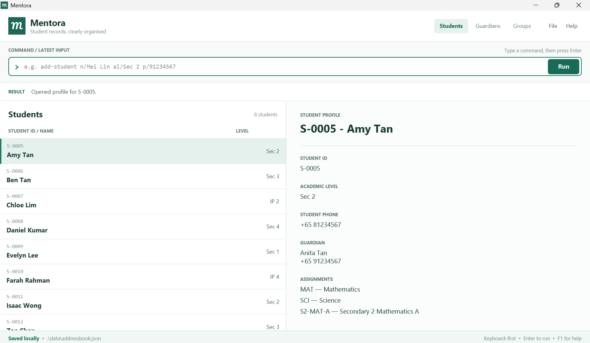
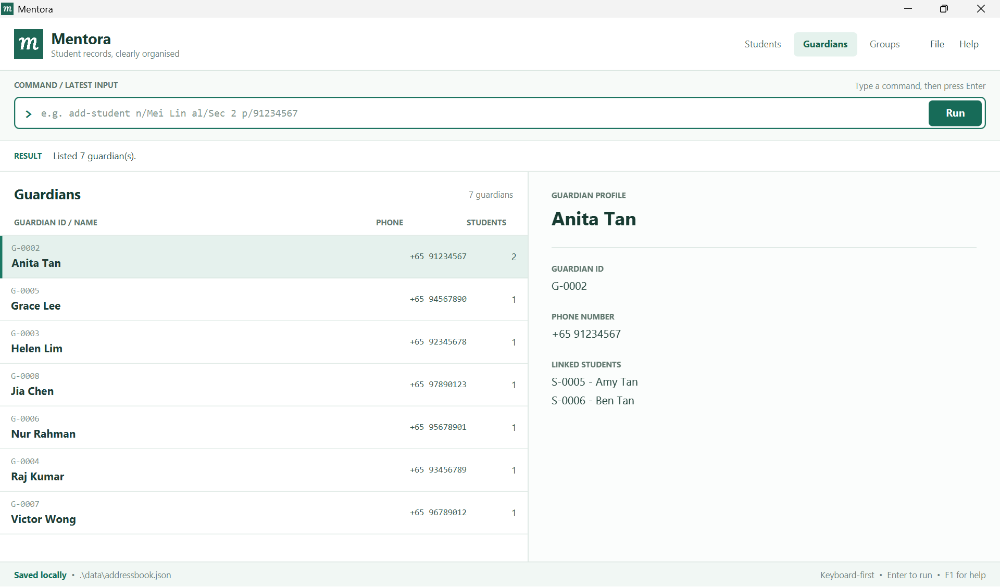
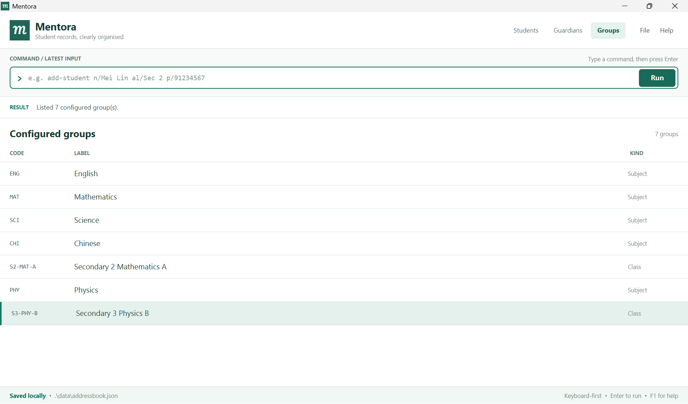

# Mentora User Guide

Mentora helps coordinators of small private tuition centres in Singapore manage student and guardian contacts through typed commands. It is designed for one coordinator working locally with approximately 30–200 active and prospective secondary-school students.

Use Mentora to keep student details, subject or class assignments, and guardian contact information together. Siblings can share a guardian record, so one saved contact can appear in every linked student's profile.

Start with [Getting started](#getting-started), or jump to the [Command summary](#command-summary) when you need a format quickly. This guide describes the current Mentora build. For an older download, consult its release notes and bundled `help`; the [v1.4 release notes](ReleaseNotes.md) describe that historical version.

* Table of Contents
{:toc}

## Getting started

### Installation

1. Install **Java 25**. Open a terminal (PowerShell on Windows) and run `java -version`. Check that it reports version `25` before continuing.
1. Download the JAR asset from the [official Mentora releases page](https://github.com/AY2627S1-CS2103T-T10-4/tp/releases). Choose the `.jar` asset, not the source-code archive.
1. Put the JAR in a folder where you can create and update files, such as a new `Mentora` folder under Documents. Keep your normal records separate from any folder used to try sample commands.
1. Open a terminal **in that folder**. On Windows, for example, enter `cd "$env:USERPROFILE\Documents\Mentora"` in PowerShell. Launch with the JAR's exact filename:

   ```text
   java -jar "mentora.jar"
   ```

   Downloaded assets can use a different filename or capitalization: the historical v1.4.1 asset is `Mentora.jar`, launched with `java -jar "Mentora.jar"`. Double-clicking a JAR may not work on every system; use the terminal command.
1. When Mentora opens, type `help` in its command box and press **Enter**. Terminal commands such as `java -jar` belong in the terminal, not Mentora's command box.

**Building from source:** Follow [Setting up and getting started](SettingUp.md) and the [Shadow JAR instructions](DevOps.md#build-automation). The current build generates `build/libs/mentora.jar` directly. Copy that JAR to your writable application folder and launch it there with `java -jar "mentora.jar"`; no manual renaming is needed.

**First launch:** When no `data/addressbook.json` exists, this build starts with two sample students, Mei Lin and S. Kumar, and the default groups. These are demonstration records. Review them before using [`delete-student`](#deleting-a-student-delete-student) to remove them.

**Upgrading:** Close Mentora and back up `data/addressbook.json` before replacing the JAR. Launch the new JAR from the same folder to continue using your records. See [Saving and reopening](#saving-and-reopening).

### Finding your way around



_Synthetic example records in the Students workspace. [View full-size screenshot](images/Ui.png)._

The **command box** accepts one command at a time; press **Enter** to run it. Read the **result panel** for success or an explanation of what needs correcting.

| Tab | What you can see and do |
|---|---|
| **Students** | Browse IDs, names and academic levels. Select a row to see the full name, student phone, assignments and linked guardian. Long list names may be shortened with an ellipsis; the profile retains the full name. |
| **Guardians** | Browse guardian IDs, names, phone numbers and linked-student counts. Select a row to see the guardian's details and linked students. |
| **Groups** | Browse the configured Subject and Class codes, labels and kinds. Use these codes for assignments. |

Click a tab to switch workspace. A tab switch retains the existing lists and filters; it does not run a new search. Student commands such as `add-student`, `edit-student`, `list-students`, `find-student` and `view-student` keep the current tab, so select **Students** to see their results. Guardian list/search commands open Guardians; listing, creating or deleting groups opens Groups. Linking or unlinking guardians and changing assignments opens Students.

The **status bar** shows the data-file location and a persistent `Saving disabled` warning during recovery. Check the result panel for save failures; the normal `Saved locally` footer is not confirmation that the latest command succeeded.

### Registering your first student

Try this walkthrough in a fresh application folder. It uses new sample records so it does not duplicate the bundled Mei Lin student.

1. Select **Students**, then enter `add-student n/Amy Tan al/Sec 2 p/81234567`. The result confirms the addition and shows a generated `S-` ID. Copy that ID; it is called `STUDENT_ID` below.
1. Enter `add-guardian n/Anita Tan p/91234567` and copy the generated `G-` ID as `GUARDIAN_ID`. This creates a separate contact; the student's and guardian's numbers are independent.
1. Enter `link-guardian sid/STUDENT_ID gid/GUARDIAN_ID`, replacing both placeholders with those actual IDs. The Students tab opens and Amy's profile shows Anita's contact.
1. Enter `list-groups` to see the default catalogue, then `assign-group sid/STUDENT_ID g/MAT`. The Students tab opens and Amy's profile shows Mathematics under Assignments. If using an existing register where `MAT` was removed, use a listed group code instead.
1. Enter `find-student n/Amy` to find Amy, then `list-students` to restore the full list. To see a command's format again, enter `help edit-student`.

Do not type `STUDENT_ID` or `GUARDIAN_ID` literally. Use `list-students` and `list-guardians` to recover IDs later. If you repeat the walkthrough in the same folder, reuse the existing records and IDs instead of adding duplicates.

## Understanding commands and values

Words in `UPPER_CASE` are placeholders: replace `NAME` with a name such as `Mei Lin`. Do not type the placeholder itself. Square brackets mark optional fields; omit the brackets when typing.

Examples below are independent illustrations, not one continuous script. Replace example IDs such as `S-0007` and `G-0003` with IDs from your register. The records, groups and relationships used by an example must exist first; example counts depend on your own data.

* Commands and prefixes are case-insensitive. Use the lowercase spellings shown in this guide for consistency.
* Prefixes identify fields: `n/` for a name or query, `al/` for academic level, `p/` for phone, `sid/` for student ID, `gid/` for guardian ID, `g/` for group code, `l/` for group label, and `k/` for group kind.
* Prefixed fields can appear in any order, but each prefix may appear only once. All fields shown outside square brackets are required and must contain a value.
* Missing fields, repeated or unknown prefixes, and invalid values are rejected. The result gives either the required command format or a field-specific correction. Follow that feedback or use `help COMMAND`.
* `list-students`, `list-groups` and `list-guardians` reject extra text. `help` accepts at most one command name. Type `exit` on its own; this build ignores extra arguments.
* Leading and trailing spaces in values are removed. Repeated spaces within names and search queries become one space. Name casing is retained for display; searches ignore case. See the [current Unicode length limits](#scope-and-limitations).
* Use permanent IDs such as `S-0007` and `G-0003`, **not list positions**. Searching or sorting does not change an ID. IDs are generated by Mentora and cannot be edited; they use uppercase `S-` or `G-` followed by at least four digits.

### Accepted values

| Value | What you can enter | Examples |
|---|---|---|
| Name | 1–80 characters after spaces are normalized. Must start and end with a Unicode letter; only letters, spaces, apostrophes, hyphens, and periods between letters are allowed. | `Mei Lin`, `O'Connor`, `S. Kumar` |
| Academic level | `Sec 1` through `Sec 5`, or `IP 1` through `IP 6`, case-insensitive. | `Sec 2`, `ip 4` (displayed as `IP 4`) |
| Phone | Eight digits starting with `3`, `6`, `8`, or `9`, optionally preceded by `+65` and a single space. No hyphens, brackets, or extensions. | `91234567`, `+6591234567`, `+65 91234567` all display as `+65 91234567` |
| Student or guardian ID | An existing generated ID of the correct type. | `sid/S-0007`, `gid/G-0003` |
| Group code | For a new group, 2–20 ASCII letters, digits, or hyphens; starts with a letter and ends with a letter or digit. Existing-group commands require an exact code from `list-groups`. Codes are case-insensitive and display in uppercase. | `MAT`, `S2-MAT-A` |
| Group label | 1–80 characters after leading, trailing, and repeated internal whitespace are normalized. | `Physics`, `Secondary 3 Physics B` |
| Group kind | `Subject` or `Class`, case-insensitive. | `Subject`, `class` (displayed as `Class`) |
| Search query | 1–80 characters after spaces are normalized, following the name character rules. Can be a whole or partial name. | `mei`, `Mei Lin` |

## Managing students

### Adding a student: `add-student`

Format: `add-student n/NAME al/ACADEMIC_LEVEL [p/PHONE]`

Creates a student with a generated ID, no guardian, and no subject or class assignments. The list refreshes and selects the new student. If a search filter hides the new record, it is cleared after saving succeeds.

Alternative examples (choose one for each new student; the name and level must not already exist):

* `add-student n/Amy Tan al/Sec 2`
* `add-student n/Amy Tan al/Sec 2 p/81234567`
* `add-student al/IP 4 n/Daniel Ng`

Example result for the first command: `Added student S-0007: Amy Tan (Sec 2).`

A student with the same normalized name and academic level is rejected with, for example, `A student named Amy Tan at Sec 2 already exists.` The same name at different levels is allowed.

The optional student phone uses the same Singapore number validation and canonical `+65 XXXXXXXX` display as a guardian phone. It is stored on the student record, is not required to be unique, and is separate from a linked guardian's number. Without a number the profile says `Phone: none`. Successful creation with a number reports `Added student S-0007: Amy Tan (Sec 2) with phone +65 81234567.`

**MVP limitation:** This rule also rejects two different students who share both their name and academic level. The MVP does not yet provide a way to distinguish them.

### Updating academic level or phone: `edit-student`
{: #updating-academic-level-edit-student}

Format: `edit-student sid/STUDENT_ID [al/ACADEMIC_LEVEL] [p/PHONE]`

Supply at least one of `al/` or `p/`. Both can be supplied in the same command.

Examples:

* `edit-student sid/S-0007 al/Sec 3` changes the level.
* `edit-student sid/S-0007 p/98765432` adds or replaces the student's phone.
* `edit-student sid/S-0007 al/Sec 3 p/98765432` updates both.

When changing only the academic level, Mentora retains the same ID, name, student phone, group assignments, and guardian link. The list and selected profile refresh, with a result such as `Updated student S-0007: academic level is now Sec 3.` Review class assignments separately when a student moves up a level.

Lookup and duplicate checks use every registered student, including records hidden by a search. After a successful edit, a filter hiding the target is cleared and that student is selected. The command keeps the current tab; select Students if another tab is open.

If the change would duplicate another student's name and level, it is rejected: `Cannot update S-0007: a student named Mei Lin at Sec 3 already exists.` This command does not edit names.

To add or replace the student's own number, use `edit-student sid/S-0007 p/98765432`. Success reports `Updated student S-0007 phone to +65 98765432.` The number is validated by the shared Singapore phone rule, may be shared with other records, and does not change the guardian phone. An unknown ID reports `Student S-0007 does not exist.`; a save failure retains the old number and reports `Could not save changes. Student S-0007 was not updated.` There is no command to clear an existing student phone.

### Listing students: `list-students`

Format: `list-students`

Shows every registered student's ID, name and academic level, sorted by normalized name and then ID. Use it to return to the full list after a search. Guardian status is shown in the selected student's profile, not the list.

The result reports the number of students, for example `Listed 8 student(s).` If there are none, it says `No students registered.`

### Finding students by name: `find-student`

Format: `find-student n/QUERY`

Examples:

* `find-student n/mei` finds names containing `mei`, such as `Mei Lin` and `Mei Wen`.
* `find-student n/Mei Lin` finds names containing the phrase `Mei Lin`.

Matching ignores case and uses a substring of the normalized name, so partial names work. A multiword query is one phrase, not separate alternative keywords. This command does not search guardian names, academic levels, or assignments.

The main list shows all matches. One result reports `Found 1 student matching "mei".` Multiple results report `Found N students matching "mei".`, where `N` is the number of matches. A valid query with no matches reports `No students match "mei".`

Search and list commands change only the displayed Student list and do not save data. They keep the current tab; select Students to see results if another tab is open.

### Filtering students: `filter-students`

Formats: `filter-students g/GROUP_CODE` or `filter-students al/ACADEMIC_LEVEL`

Examples:

* `filter-students g/MAT` shows students assigned to Mathematics.
* `filter-students al/Sec 2` shows students whose academic level is Sec 2.

Supply exactly one variant. Group codes and academic levels ignore case. Group filtering accepts configured
**Subject** groups such as `MAT`; Class groups such as `S2-MAT-A` are rejected. Academic-level filtering accepts
`Sec 1` through `Sec 5` or `IP 1` through `IP 6`, independently of group assignments.

Both variants open Students and show the active filter above the list. Each search replaces the previous student
filter and considers the complete register. Results appear once each, sorted by normalized name and permanent
ID. Select a row to open its profile. Run `list-students` to restore all students and clear the filter summary;
`find-student` also replaces the filter. Filtering never saves or changes stored records.

Example results are `Found 2 student(s) assigned to MAT.` and `Found 3 student(s) at Sec 2.` With no matches,
the list is empty and the result is `No students are assigned to MAT.` or `No students are at Sec 2.`

Unknown codes report `Group CODE is not configured. Run list-groups to see available groups.` A Class group
reports `Group S2-MAT-A is a Class group; use the academic-level filter.` Invalid levels use the shared
academic-level error. Missing, empty, repeated, mixed or extra parameters report the applicable format error:
`Invalid command format. Use: filter-students g/GROUP_CODE` or
`Invalid command format. Use: filter-students al/ACADEMIC_LEVEL`. Rejected filters preserve the tab and results.

Assignment changes refresh group-filter membership. If a successful modifying or profile-opening command
requests a student hidden by the filter, the filter is cleared to reveal that student. Failed saves restore the
previous data and filtered view. Filtering remains available during storage recovery, with an empty register.

### Opening a student profile: `view-student`

Format: `view-student sid/STUDENT_ID`

Example: `view-student sid/S-0007`

Selects the student's read-only profile and reports `Opened profile for S-0007.` The profile shows academic level, student phone (or `Phone: none`), assignments with codes and labels, and the linked guardian's current name and canonical phone number, or `Guardian: none`. The two phone numbers are independent. If a search hides the student, the filter is cleared after successful lookup. The command keeps the current tab: select Students if another tab is open. It never saves data.

Use the ID shown in the student list or search results. To change information, use the relevant editing, linking, or assignment command.

### Deleting a student: `delete-student`

Format: `delete-student sid/STUDENT_ID`

Example: `delete-student sid/S-0007`

**Deletion permanently removes the student record, that student's group assignments, and that student's guardian link.** Check the ID and profile before using this command. It is intended for records created by mistake, not for archiving withdrawn or graduated students.

The command finds the ID in the complete register, even when Search hides the student. Other students, their assignments, all guardian records, and other students' guardian links are retained. Deleting a student never deletes the linked guardian.

Deleting the selected student clears the selection and profile. Deleting another student preserves the current selection. The search filter and active tab remain unchanged.

Example result: `Deleted student S-0007: Mei Lin.` If the student had a linked guardian, the result also says `Guardian link removed; guardian G-0003 was retained.` An unknown ID reports `Student S-0007 does not exist.` If saving fails, the complete register, filter, selection and workspace are restored, and the result says `Could not save changes. Student S-0007 was not deleted.`

## Managing guardians and relationships

### Adding a guardian: `add-guardian`

Format: `add-guardian n/NAME p/PHONE`

Examples:

* `add-guardian n/Anita Lim p/91234567`
* `add-guardian p/+65 61234567 n/Raj Kumar`

Creates a guardian record and reports its ID, for example `Added guardian G-0003: Anita Lim (+65 91234567).` Guardians are saved independently. Browse them with `list-guardians` or search their names with `find-guardian`.

Phone numbers must be unique after normalization. If the number is already recorded, the result identifies the existing guardian: `A guardian with phone +65 91234567 already exists (G-0003). Link that guardian instead.` Different guardians may have the same name, but cannot have the same phone number in the MVP.

### Listing guardians: `list-guardians`

Format: `list-guardians`

Switches to the Guardians tab, clears any guardian filter, and lists every guardian by normalized name and then guardian ID. Each row shows the guardian's ID, name, canonical phone number and linked-student count. Selecting a row shows the guardian profile and every linked student's ID and name.

The result is `Listed 6 guardian(s).`, using the actual number of guardian records. An empty register reports and displays `No guardians registered.` Command casing is ignored. Extra input reports `Invalid command format. Use: list-guardians` and leaves the current tab and list unchanged. Listing guardians is read-only and does not rewrite local data.



_Anita Tan is shared by Amy and Ben; the selected profile lists both students. [View full-size screenshot](images/Guardians.png)._

### Searching guardians by name: `find-guardian`

Format: `find-guardian n/QUERY`

Examples: `find-guardian n/anita`; `find-guardian n/Anita Lim`

Switches to the Guardians tab and displays names containing the query, ignoring case and normalizing whitespace. A multiword query is matched as one phrase. Results are sorted by normalized name and then guardian ID. Guardians with the same name remain separate records. Phone numbers, IDs and linked student names are not searched.

Each row shows the contact details and linked-student count; selecting a row shows its linked students. One result reports `Found 1 guardian matching "anita".` Multiple results report `Found N guardians matching "anita".`, where `N` is the number of matches. A search with no results shows an empty list and `No guardians match "anita".` Run `list-guardians` to clear the search.

Queries must contain 1-80 characters after whitespace normalization and follow the shared name rules. Invalid values report `Search query must be 1-80 characters and contain name characters only.` Missing or blank queries, repeated prefixes and additional parameters report `Invalid command format. Use: find-guardian n/QUERY`. Rejected searches preserve the current tab and list.

Guardian search does not alter student filters or stored records and remains available during storage recovery.

### Updating a guardian's phone: `edit-guardian`

Format: `edit-guardian gid/GUARDIAN_ID p/PHONE`

Example: `edit-guardian gid/G-0003 p/+65 98765432`

Updates the shared guardian's phone while retaining their ID, name, all student links and group assignments. Every linked student profile then shows the new number, including an affected profile that is already open. The current workspace and selected student are retained.

Phones require eight digits starting with `3`, `6`, `8` or `9`, optionally prefixed by `+65` with zero or one following space. Leading/trailing spaces are removed. `98765432`, `+6598765432` and `+65 98765432` all display as `+65 98765432`. Invalid phone values report `Phone number must be an 8-digit Singapore number, optionally prefixed by +65.`

Example result: `Updated guardian G-0003 phone to +65 98765432. Updated contact will appear in 2 linked student profile(s).` The count depends on the guardian's links.

If another guardian already uses the normalized number, the update is rejected with, for example, `Phone +65 98765432 is already used by guardian G-0004.` An unknown ID reports `Guardian G-0003 does not exist.` Neither rejection changes the register.

Supplying the current phone number, including an equivalent local or `+65` form, reports the normal success message and linked-student count without rewriting the file.

Successful changes survive restarting Mentora. If saving fails, the previous in-memory register and phone are restored and the result says `Could not save changes. Guardian G-0003 was not updated.`, using the supplied ID. This command is blocked during load recovery, even when the supplied phone is unchanged. See [Saving and reopening](#saving-and-reopening) for recovery instructions and the normal-save limitation.

### Linking a guardian: `link-guardian`

Format: `link-guardian sid/STUDENT_ID gid/GUARDIAN_ID`

Example: `link-guardian sid/S-0007 gid/G-0003`

Links an existing student to an existing guardian. After saving succeeds, Mentora opens Students and selects that student's profile, which shows the guardian's name and number. Use `list-guardians` to find the guardian ID; the student's profile does not show that ID.

Example result: `Linked student S-0007 (Mei Lin) to guardian G-0003 (Anita Lim, +65 91234567).`

Each student can have **one guardian** in the MVP. A guardian can be linked to multiple students: for example, `link-guardian sid/S-0008 gid/G-0003` links a second student to the same guardian.

Repeating a link reports `Student S-0007 is already linked to guardian G-0003.` Trying to link a different guardian while a link exists reports `Student S-0007 already has guardian G-0003. Unlink it before linking another guardian.`

### Removing or correcting a guardian link: `unlink-guardian`

Format: `unlink-guardian sid/STUDENT_ID`

Example: `unlink-guardian sid/S-0007`

Removes the relationship while keeping both records and the guardian's links to other students. The profile shows `Guardian: none`.

Example result: `Removed guardian G-0003 from student S-0007. Guardian record was retained.` If there is no existing link, it reports `Student S-0007 has no guardian to unlink.`

To correct a link, run `unlink-guardian` and then `link-guardian` with the correct guardian ID. Successful unlinking opens the Students tab and refreshes the target profile, including when it is already selected. A filter hiding the student is cleared after saving succeeds. The guardian list count and linked-student details also refresh.

An unknown ID reports `Student S-0007 does not exist.` If saving fails, the relationship is restored and the result says `Could not save changes. The guardian link was not removed.` Invalid input leaves the current tab and list unchanged. Unlinking is unavailable during storage recovery.

## Managing subjects and classes

### Viewing available groups: `list-groups`

Format: `list-groups`

Switches to the Groups tab and shows your saved catalogue. A new catalogue starts with these five groups:

| Code | Label | Kind |
|---|---|---|
| ENG | English | Subject |
| MAT | Mathematics | Subject |
| SCI | Science | Subject |
| CHI | Chinese | Subject |
| S2-MAT-A | Secondary 2 Mathematics A | Class |

These five groups are the default catalogue. Groups created with `add-group` appear after the existing entries and remain available after Mentora restarts. You can also open the catalogue by selecting the Groups tab. Select Students to return to the existing student list and selection.



_The catalogue includes the five defaults plus Physics (PHY) and Secondary 3 Physics B (S3-PHY-B). [View full-size screenshot](images/Groups.png)._

For the default catalogue, the result is `Listed 5 configured group(s).` The count reflects your actual saved groups. Command casing is ignored, so `LIST-GROUPS` also works. Extra input, such as `list-groups MAT`, reports `Invalid command format. Use: list-groups`.

Browsing groups does not change or save data. Use `add-group` to extend the catalogue and `delete-group` to remove an unused group.

### Creating a group: `add-group`

Format: `add-group g/GROUP_CODE l/GROUP_LABEL k/GROUP_KIND`

Examples:

* `add-group g/PHY l/Physics k/Subject`
* `add-group k/Class g/S3-PHY-B l/Secondary 3 Physics B`

Creates a reusable Subject or Class group without assigning any students. Prefixes may appear in any order and are case-insensitive. The code is stored in uppercase, the label's whitespace is normalized, and the kind is displayed as `Subject` or `Class`.

Example result: `Created group PHY (Physics, Subject).` After saving succeeds, Mentora opens the Groups tab, refreshes the catalogue, and selects the new group. The group is immediately available to `assign-group` and subject groups are available to `filter-students`.

Codes must be unique case-insensitively. Reusing a code reports `Group PHY is already configured.` Invalid values report `Group code must be 2-20 letters, digits, or hyphens, start with a letter, and end with a letter or digit.`, `Group label must be 1-80 characters.`, or `Group kind must be Subject or Class.`

Missing, empty, repeated, or unknown parameters show:

> Invalid command format. Use: add-group g/GROUP_CODE l/GROUP_LABEL k/GROUP_KIND<br>
> GROUP_KIND must be Subject or Class.<br>
> Example: add-group g/PHY l/Physics k/Subject

If saving fails, the group is removed from memory again and the result says `Could not save changes. No group was created.` Group creation is unavailable during storage recovery.

### Deleting a group: `delete-group`

Format: `delete-group g/GROUP_CODE`

Example: `delete-group g/S3-PHY-B`

Permanently removes one existing group without deleting students or guardians. To prevent accidental assignment loss, Mentora deletes only groups with no assigned students. Use `unassign-group` for each student before deleting an assigned group.

Example result: `Deleted group S3-PHY-B: Secondary 3 Physics B (Class).` After saving succeeds, Mentora opens the Groups tab and refreshes the catalogue. The deleted code is no longer available to assignment or filtering commands.

An assigned group is retained and reports `Group S3-PHY-B is assigned to 4 student(s). Remove those assignments before deleting it.` An unknown code uses the normal group-not-configured message. Missing, empty, repeated, or unknown parameters report `Invalid command format. Use: delete-group g/GROUP_CODE`.

If saving fails, the group is restored and the result says `Could not save changes. Group S3-PHY-B was not deleted.` Successful deletion is permanent and has no undo command. Group deletion is unavailable during storage recovery.

### Assigning a group: `assign-group`

Format: `assign-group sid/STUDENT_ID g/GROUP_CODE`

Examples:

* `assign-group sid/S-0007 g/MAT`
* `assign-group g/S2-MAT-A sid/S-0007`

Adds one configured group to an existing student's profile. A student may have multiple distinct assignments. `MAT` and `S2-MAT-A` are separate assignments; add both if needed. The command does not restrict class assignments based on academic level.

Example result: `Assigned group S2-MAT-A (Secondary 2 Mathematics A) to student S-0007.` The application opens Students, selects the target and refreshes Assignments, including when that student was already selected. A search filter hiding the target is cleared only after saving succeeds. Selecting another student shows their assignments. Scroll the profile when a long name or several assignments exceed the available space; an unassigned student shows `No groups assigned.`

The same group cannot be added twice: `Student S-0007 is already assigned to S2-MAT-A.` An unavailable code reports `Group CODE is not configured. Run list-groups to see available groups.`

An unknown student reports `Student S-0007 does not exist.` Group-code comparisons ignore case and feedback uses the canonical uppercase code. Successful assignments survive restarting the application. If saving fails, the in-memory change is rolled back, the previous profile state is restored, and the result says `Could not save changes. The group was not assigned.` See the normal-save limitation below.

### Removing a group assignment: `unassign-group`

Format: `unassign-group sid/STUDENT_ID g/GROUP_CODE`

Examples:

* `unassign-group sid/S-0007 g/S2-MAT-A`
* `unassign-group g/mat sid/S-0007`

Removes exactly one existing assignment, including a student's final assignment. This does not delete the student: their ID, name, academic level and guardian link remain unchanged, as do all guardian records, other assignments, other students and the configured group catalogue.

Example result: `Removed group S2-MAT-A from student S-0007.` After saving succeeds, Mentora opens Students, selects the target and refreshes the profile, including when that student was already selected. Removing the final assignment shows `No groups assigned.` Switching students or workspaces continues to show the current assignments.

The command finds students in the complete register. If a search hides the target, its filter is cleared only after saving succeeds; a filter that already includes the target is retained.

Group codes are case-insensitive and feedback uses their canonical uppercase form.

An unknown student reports `Student S-0007 does not exist.` An unavailable group reports `Group CODE is not configured. Run list-groups to see available groups.` If the configured group is not assigned to the student, the result is `Student S-0007 is not assigned to S2-MAT-A.`

Successful removals survive restarting Mentora. Rejected commands preserve the previous register, search filter, selection and workspace. If saving fails, the in-memory removal is rolled back and the result says `Could not save changes. The group assignment was not removed.` Syntactically valid removals are blocked during load recovery. See [Saving and reopening](#saving-and-reopening) for recovery instructions and the normal-save limitation.

When a student changes class, remove their old class assignment and assign the new class using its configured code.

## Help, saving, and closing

### Getting help: `help`

Format: `help [COMMAND]`

Enter `help` to open or bring forward the command overview. The result says `Opened help window.`
Enter `help add-student`, for example, to display that command's syntax, examples, validation rules and common
errors. The result says `Showing help for add-student.` Command names ignore case. A new request updates the
same help window, and `help` or the Help menu/F1 returns it to the overview.

Help content is bundled with Mentora and works offline, including during storage recovery. The copy button
copies the URL of this Mentora User Guide; opening the online guide requires an internet connection.
An unknown name reports `No help is available for "COMMAND". Run help to see all commands.` More than one
argument reports `Invalid command format. Use: help [COMMAND]`. Rejected requests keep the previous help page.
Help is read-only: `help exit`, for example, describes `exit` without closing Mentora.

### Saving and reopening

Mentora automatically saves students, guardians, groups, links and assignments after successful changes. There is no manual save command. Viewing, searching, filtering, listing and opening help do not rewrite records; neither does `exit`. Saving while a list is filtered still saves the complete register.

Your records are stored in **`data/addressbook.json`**, relative to the folder from which you launched Mentora. The location appears in the status bar. Start from the same folder each time, and use only one running copy with that data file. No account or internet connection is needed.

When you reopen Mentora, it reloads the saved register. If the data file is missing, Mentora starts with an empty register. A valid data file containing an empty register also opens with no students. A zero-byte file is not a valid empty register. Previously saved groups, including an empty catalogue, are retained.

#### Backing up and restoring

Close Mentora, then copy `data/addressbook.json` to a separate backup folder. Keep a backup before upgrading or deleting important records. To restore, close Mentora, preserve a copy of the current file, put the chosen backup at the same data-file path, and restart.

#### If saving fails

Read the command result. For example, a failed addition reports `Could not save changes. No student was added.` Mentora restores the previous records in memory, so the requested change has not taken effect there. The normal `Saved locally` footer does not override this error.

Check that the folder is writable and the drive has space. **A failed or interrupted save can leave an incomplete data file**, even though the previous records remain visible in the app. Keep backups and preserve a copy of the affected file before trying recovery. Do not treat the failed command as saved.

#### If loading fails

Mentora preserves the original file, shows empty student and guardian lists, and disables changes and saving for that session. It reports:

> Could not load local data. Your original data file was not changed; restore or replace it before saving.

An empty list in recovery does not mean your original records have been deleted. The footer says `Saving disabled`; hover over it for the failure reason. You can still list, search, filter, browse groups, open help and exit. Commands that change records, relationships or groups are blocked.

1. Close Mentora.
1. Copy the original `data/addressbook.json` somewhere safe before changing it.
1. Restore a known valid backup, or obtain help repairing the preserved file. Do not replace it with a blank file.
1. Restart Mentora. Saving stays disabled in the old session even if the file is repaired while it is open.

Unreadable files, damaged JSON, invalid field values or inconsistent/duplicate records can trigger recovery. Avoid manually editing your normal data file.

### Closing Mentora: `exit`

Format: `exit`

Closes the application and reports `Closing Mentora.` Successful data-changing commands have already saved before returning their success feedback. Use `exit` on its own. This build also closes if extra arguments are supplied.

## Troubleshooting

| Message or problem | What to do |
|---|---|
| Java is not found or reports another version | Install Java 25 and check `java -version` in the same terminal used to launch Mentora. |
| Unable to access the JAR file | Open the terminal in the JAR's folder and use its exact filename, including capitalization. |
| `Invalid command format. Use: FORMAT` | Follow the displayed format. Include each required prefix once, provide non-empty values, and remove unknown or extra input. Use this guide's examples. |
| `Name must be 1-80 characters and contain letters, spaces, apostrophes, hyphens, or periods only.` | Check the length and characters, including that the name starts and ends with a letter. |
| `Academic level must be Sec 1-5 or IP 1-6.` | Enter a value such as `Sec 2` or `IP 4`, rather than `Secondary two`. |
| `Phone number must be an 8-digit Singapore number, optionally prefixed by +65.` | Use eight digits starting with 3, 6, 8, or 9. Remove hyphens, brackets, and extensions. |
| `Search query must be 1-80 characters and contain name characters only.` | Search with a whole or partial name following the accepted name rules. |
| `Student S-0007 does not exist.` | Copy the correct student ID from the Students list or selected profile. Do not use the row number. |
| `Guardian G-0003 does not exist.` | Run `list-guardians` or `find-guardian n/NAME` and copy the ID from the guardian row or profile. Create the guardian first if it has not been registered. |
| No students match a query | Try a shorter part of the name or run `list-students`. Search does not cover guardian names, levels, or groups. |
| A duplicate student or phone number is rejected | Check whether the record already exists. Reuse a shared guardian's ID for siblings. See the duplicate restrictions in the adding sections. |
| A group code is not configured | Run `list-groups` and use an exact listed code. |
| A group cannot be deleted | Run `unassign-group` for every assigned student, then retry `delete-group`. |
| `Could not save changes.` | The change was rolled back in memory. Check the folder permissions and available space, and follow [save-failure guidance](#if-saving-fails) before retrying. |
| A load error appears with an empty list | Follow the recovery guidance under [Saving and reopening](#saving-and-reopening); preserve the original file. |
| A documented command is reported as unknown | Check the [Command summary](#command-summary), then `help` in your installed version. An older download may not support newer commands. |

## Scope and limitations

The MVP supports student records, one guardian per student, shared guardians, creation and safe deletion of subject/class groups, group assignments, student-name and guardian-name search, subject/level filtering, profiles, command help, and local storage for one coordinator at a time.

The following are **not included in the MVP**:

* Multiple guardians per student or editing an existing group's code, label, or kind.
* Editing student or guardian names, clearing a student's recorded phone, or deleting guardian records.
* A command to jump to an edit screen.
* Prospect-to-active conversion, active-only lists, and archiving withdrawn or graduated students.
* Class guardian contact lists and deduplicated, copyable lists for announcements.
* Importing or exporting contact lists and general incomplete-record reporting.

**Current Unicode length limits:** Some less common letters count as two characters toward the name and search-query length limit. Group labels also count some less common characters as two toward their length limit.

Mentora does not manage attendance, lesson content, grades, fees, payroll, or accounting. It does not send WhatsApp, SMS, or email messages or provide real-time collaboration between staff.

## Frequently asked questions

**Can siblings share a guardian?** Yes. Add the guardian once and link each student to the same guardian ID. The current guardian name and phone are shown in every linked student's profile. Use `edit-guardian` to update that shared phone number for every linked student.

**Does deleting a student delete their guardian?** No. It removes that student and their relationship, preserving the guardian and other students' links.

**Does changing academic level move the student to a new class?** No. Academic level and group assignments are independent. Use `unassign-group` to remove the old assignment and `assign-group` to add the new class.

**Why can I not delete a group?** Mentora prevents deletion while any student is assigned to the group. Remove each assignment with `unassign-group`, then run `delete-group` again.

**Can I keep a withdrawn student's record without showing it in the main list?** Archiving and active-only lists are deferred. Deletion is permanent and is not an archive operation.

**Can two guardians use the same number?** The MVP treats the normalized phone number as unique, so separate guardian records cannot share a number.

## Command summary

These are the commands supported by the current MVP build. Replace example IDs with IDs from your own records.

| Action | Format | Example |
|---|---|---|
| Add student | `add-student n/NAME al/ACADEMIC_LEVEL [p/PHONE]` | `add-student n/Amy Tan al/Sec 2 p/81234567` |
| Update level and/or phone (at least one) | `edit-student sid/STUDENT_ID [al/ACADEMIC_LEVEL] [p/PHONE]` | `edit-student sid/S-0007 p/98765432` |
| Delete student permanently | `delete-student sid/STUDENT_ID` | `delete-student sid/S-0007` |
| List all students | `list-students` | `list-students` |
| Find students by name | `find-student n/QUERY` | `find-student n/mei` |
| Filter students by subject | `filter-students g/GROUP_CODE` | `filter-students g/MAT` |
| Filter students by academic level | `filter-students al/ACADEMIC_LEVEL` | `filter-students al/Sec 2` |
| Open student profile | `view-student sid/STUDENT_ID` | `view-student sid/S-0007` |
| Add guardian | `add-guardian n/NAME p/PHONE` | `add-guardian n/Anita Lim p/91234567` |
| List all guardians | `list-guardians` | `list-guardians` |
| Find guardians by name | `find-guardian n/QUERY` | `find-guardian n/anita` |
| Update guardian phone | `edit-guardian gid/GUARDIAN_ID p/PHONE` | `edit-guardian gid/G-0003 p/98765432` |
| Link guardian | `link-guardian sid/STUDENT_ID gid/GUARDIAN_ID` | `link-guardian sid/S-0007 gid/G-0003` |
| Unlink guardian | `unlink-guardian sid/STUDENT_ID` | `unlink-guardian sid/S-0007` |
| View configured groups | `list-groups` | `list-groups` |
| Create group | `add-group g/GROUP_CODE l/GROUP_LABEL k/GROUP_KIND` | `add-group g/PHY l/Physics k/Subject` |
| Delete unused group | `delete-group g/GROUP_CODE` | `delete-group g/PHY` |
| Assign group | `assign-group sid/STUDENT_ID g/GROUP_CODE` | `assign-group sid/S-0007 g/MAT` |
| Remove group assignment | `unassign-group sid/STUDENT_ID g/GROUP_CODE` | `unassign-group sid/S-0007 g/MAT` |
| Get help | `help [COMMAND]` | `help add-student` |
| Exit | `exit` | `exit` |
