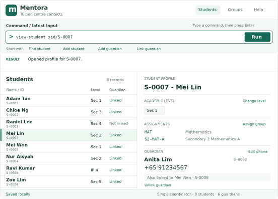
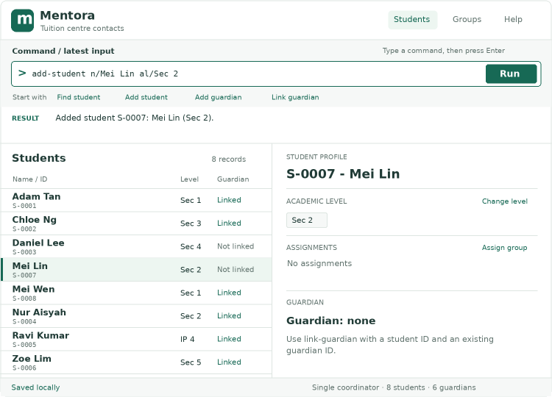
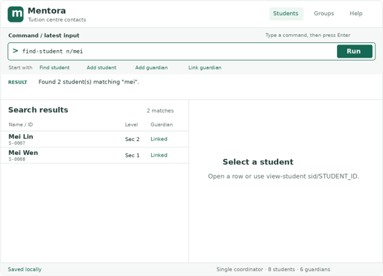
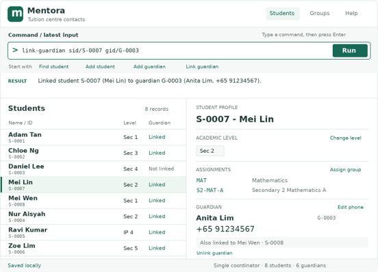
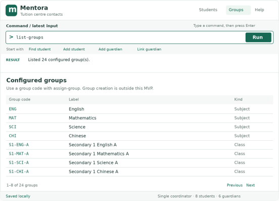
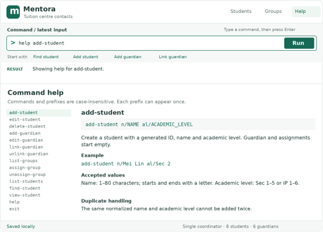

# Mentora User Guide

Mentora helps coordinators of small private tuition centres in Singapore manage student and guardian contacts through typed commands. It is designed for one coordinator working locally with approximately 30–200 active and prospective secondary-school students.

Use Mentora to keep student details, subject or class assignments, and guardian contact information together. Siblings can share a guardian record, so one saved contact can appear in every linked student's profile.

> **Current MVP build:** Supported commands are `add-student`, `edit-student`, `delete-student`, `add-guardian`, `list-guardians`, `link-guardian`, `unlink-guardian`, `view-student`, `find-student`, `list-students`, `list-groups`, `assign-group`, `help`, and `exit`. Student phone can be entered during creation or updated with `edit-student`; guardian phone remains a separate contact. The five configured groups can be assigned to students and displayed in their profiles. Editing a guardian's phone, removing an assignment, and command-specific help are not yet available. Legacy Address Book commands are no longer accepted. Interface images are mockups, and example IDs and counts are illustrative. See the [MVP Release Notes](ReleaseNotes.md) for a concise shipped-feature summary.

* Table of Contents
{:toc}

## Getting started

### Installation

The project currently targets Java `25`. Release packages will be distributed through the [Mentora project releases](https://github.com/AY2627S1-CS2103T-T10-4/tp/releases). Use the package and launch instructions supplied with a release that supports the Mentora commands.

For the current source build, follow [Setting up and getting started](SettingUp.md). Its generated JAR is named `addressbook.jar` and can be launched from its folder with `java -jar addressbook.jar`. The supported commands are listed in the current-build note above.

### Finding your way around

The **command box** accepts typed commands: enter one command and press **Enter**. The **result panel** explains whether it succeeded or what needs correcting. The **main list** displays students, search results or configured groups. The **student profile** shows academic level, the student's own phone (or `Phone: none`), assignments, and the linked guardian's current name and independent phone number. The **status bar** reports local saving and loading.

### Registering your first student

Enter `add-student n/Mei Lin al/Sec 2 p/91234567` to create a student with an optional direct contact number; omit `p/` when none is recorded. The result shows the generated student ID, and the list selects the new record. Use that ID in `edit-student sid/STUDENT_ID al/Sec 3` to update the academic level or `edit-student sid/STUDENT_ID p/98765432` to add or replace the student's phone. Enter `list-groups` to browse the catalogue, then `assign-group sid/STUDENT_ID g/MAT` to assign a group. Use `add-guardian n/Anita Lim p/91234567` to create a separate guardian contact, then `link-guardian sid/STUDENT_ID gid/GUARDIAN_ID` to show that contact in the student's profile. Use `find-student n/Mei`, `list-students`, and `view-student sid/STUDENT_ID` to locate and select students. Use `delete-student sid/STUDENT_ID` to permanently remove a student by ID, `help` to open the help window, or `exit` to close Mentora.

## Understanding commands and values

Words in `UPPER_CASE` are placeholders: replace `NAME` with a name such as `Mei Lin`. Do not type the placeholder itself.

* Commands and prefixes are case-insensitive. Use the lowercase spellings shown in this guide for consistency.
* Prefixes identify fields: `n/` for a name or query, `al/` for academic level, `p/` for phone, `sid/` for student ID, `gid/` for guardian ID, and `g/` for group code.
* Prefixed fields can appear in any order, but each prefix may appear only once. All fields shown outside square brackets are required and must contain a value.
* Unknown text, unknown prefixes, repeated prefixes, and missing required fields produce `Invalid command format. Use: FORMAT`, where `FORMAT` is the correct command syntax.
* `list-groups` and `list-guardians` reject extra text. The current `help` and `exit` commands still ignore extra arguments; stricter handling and command-specific help remain planned behavior.
* Leading and trailing spaces in values are removed. Repeated spaces within names and search queries become one space. Name casing is retained for display but ignored for matching.
* Use permanent IDs such as `S-0007` and `G-0003`, **not list positions**. Searching or sorting does not change an ID. IDs are generated by Mentora and cannot be edited; they use uppercase `S-` or `G-` followed by at least four digits.

### Accepted values

| Value | What you can enter | Examples |
|---|---|---|
| Name | 1–80 characters after spaces are normalized. Must start and end with a Unicode letter; only letters, spaces, apostrophes, hyphens, and periods between letters are allowed. | `Mei Lin`, `O'Connor`, `S. Kumar` |
| Academic level | `Sec 1` through `Sec 5`, or `IP 1` through `IP 6`, case-insensitive. | `Sec 2`, `ip 4` (displayed as `IP 4`) |
| Phone | Eight digits starting with `3`, `6`, `8`, or `9`, optionally preceded by `+65` and a single space. No hyphens, brackets, or extensions. | `91234567`, `+6591234567`, `+65 91234567` all display as `+65 91234567` |
| Student or guardian ID | An existing generated ID of the correct type. | `sid/S-0007`, `gid/G-0003` |
| Group code | An exact code in `list-groups`, case-insensitive. Codes display in uppercase. | `MAT`, `S2-MAT-A` |
| Search query | 1–80 characters after spaces are normalized, following the name character rules. Can be a whole or partial name. | `mei`, `Mei Lin` |

## Managing students

### Adding a student: `add-student`

Format: `add-student n/NAME al/ACADEMIC_LEVEL [p/PHONE]`

Creates a student with a generated ID, no guardian, and no subject or class assignments. The list refreshes and selects the new student. If a search filter hides the new record, it is cleared after saving succeeds.

Examples:

* `add-student n/Mei Lin al/Sec 2`
* `add-student n/Mei Lin al/Sec 2 p/91234567`
* `add-student al/IP 4 n/S. Kumar`

Example result: `Added student S-0007: Mei Lin (Sec 2).`

A student with the same normalized name and academic level is rejected with, for example, `A student named Mei Lin at Sec 2 already exists.` The same name at different levels is allowed.

The optional student phone uses the same Singapore number validation and canonical `+65 XXXXXXXX` display as a guardian phone. It is stored on the student record, is not required to be unique, and is separate from a linked guardian's number. Without a number the profile says `Phone: none`. Successful creation with a number reports `Added student S-0007: Mei Lin (Sec 2) with phone +65 91234567.`

**MVP limitation:** This rule also rejects two different students who share both their name and academic level. The MVP does not yet provide a way to distinguish them.

### Updating academic level: `edit-student`

Format: `edit-student sid/STUDENT_ID al/ACADEMIC_LEVEL`

Example: `edit-student sid/S-0007 al/Sec 3`

Changes the student's academic level, retaining the same ID, name, student phone, group assignments, and guardian link. The list and selected profile refresh, with a result such as `Updated student S-0007: academic level is now Sec 3.` Review class assignments separately when a student moves up a level.

Lookup and duplicate checks use every registered student, including records hidden by a search. After a successful edit, a filter hiding the target is cleared and that student is selected. The command keeps the current tab; select Students if Groups is open. Command and prefix names ignore case, either prefix order works, and each nonempty prefix is required exactly once.

If the change would duplicate another student's name and level, it is rejected: `Cannot update S-0007: a student named Mei Lin at Sec 3 already exists.` This command does not edit names.

To add or replace the student's own number, use `edit-student sid/S-0007 p/98765432`. Success reports `Updated student S-0007 phone to +65 98765432.` The number is validated by the shared Singapore phone rule, may be shared with other records, and does not change the guardian phone. An unknown ID reports `Student S-0007 does not exist.`; a save failure retains the old number and reports `Could not save changes. Student S-0007 was not updated.` The level and phone prefixes may also be supplied together to update both fields in one command.

### Listing students: `list-students`

Format: `list-students`

Shows every registered student's ID, name and academic level, sorted by normalized name and then ID. Use it to return to the full list after a search. Guardian status is not displayed in this increment.

The result reports the number of students, for example `Listed 8 student(s).` If there are none, it says `No students registered.`

### Finding students by name: `find-student`

Format: `find-student n/QUERY`

Examples:

* `find-student n/mei` finds names containing `mei`, such as `Mei Lin` and `Mei Wen`.
* `find-student n/Mei Lin` finds names containing the phrase `Mei Lin`.

Matching ignores case and uses a substring of the normalized name, so partial names work. A multiword query is one phrase, not separate alternative keywords. This command does not search guardian names, academic levels, or assignments.

The main list shows all matches and reports, for example, `Found 2 student(s) matching "mei".` A valid query with no matches reports `No students match "mei".`

Search and list commands change only the displayed Student list and do not save data. They keep the current tab; select Students to see results if Groups is open.

### Opening a student profile: `view-student`

Format: `view-student sid/STUDENT_ID`

Example: `view-student sid/S-0007`

Selects the student's read-only profile and reports `Opened profile for S-0007.` The profile shows academic level, student phone (or `Phone: none`), assignments with codes and labels, and the linked guardian's current name and canonical phone number, or `Guardian: none`. The two phone numbers are independent. If a search hides the student, the filter is cleared after successful lookup. The command keeps the current tab: select Students if Groups is open. It never saves data.

Use the ID shown in the student list or search results. To change information, use the relevant editing, linking, or assignment command.

### Deleting a student: `delete-student`

Format: `delete-student sid/STUDENT_ID`

Example: `delete-student sid/S-0007`

**Deletion permanently removes the student record, that student's group assignments, and that student's guardian link.** Check the ID and profile before using this command. It is intended for records created by mistake, not for archiving withdrawn or graduated students.

The command finds the ID in the complete register, even when Search hides the student. Other students, their assignments, all guardian records, and other students' guardian links are retained. Deleting a student never deletes the linked guardian.

Deleting the selected student clears the selection and profile. Deleting another student preserves the current selection. The search filter and active tab remain unchanged.

Example result: `Deleted student S-0007: Mei Lin.` An unknown ID reports `Student S-0007 was not found.` If saving fails, the complete register, filter, selection and workspace are restored, and the result says `Could not save changes. Student S-0007 was not deleted.`

Command and prefix names ignore case. Supply exactly one nonempty `sid/` value in uppercase `S-` form followed by at least four digits. Missing, repeated or unknown prefixes, malformed IDs and extra text report `Invalid command format. Use: delete-student sid/STUDENT_ID`.

## Managing guardians and relationships

### Adding a guardian: `add-guardian`

Format: `add-guardian n/NAME p/PHONE`

Examples:

* `add-guardian n/Anita Lim p/91234567`
* `add-guardian p/+65 61234567 n/Raj Kumar`

Creates a guardian record and reports its ID, for example `Added guardian G-0003: Anita Lim (+65 91234567).` Guardians are saved independently and can be browsed with `list-guardians`; the current build has no command to search guardians by name.

Phone numbers must be unique after normalization. If the number is already recorded, the result identifies the existing guardian: `A guardian with phone +65 91234567 already exists (G-0003). Link that guardian instead.` Different guardians may have the same name, but cannot have the same phone number in the MVP.

### Listing guardians: `list-guardians`

Format: `list-guardians`

Switches to the Guardians tab, clears any guardian filter, and lists every guardian by normalized name and then guardian ID. Each row shows the guardian's ID, name, canonical phone number and linked-student count. Selecting a row shows the guardian profile and every linked student's ID and name.

The result is `Listed 6 guardian(s).`, using the actual number of guardian records. An empty register reports and displays `No guardians registered.` Command casing is ignored. Extra input reports `Invalid command format. Use: list-guardians` and leaves the current tab and list unchanged. Listing guardians is read-only and does not rewrite local data.

### Updating a guardian's phone: `edit-guardian`

**Not implemented in the current MVP build.** The following describes the planned behavior.

Format: `edit-guardian gid/GUARDIAN_ID p/PHONE`

Example: `edit-guardian gid/G-0003 p/+65 98765432`

Updates the shared guardian record. Every linked student profile then shows the new number, including an affected profile that is already open.

Example result: `Updated guardian G-0003 phone to +65 98765432. Updated contact will appear in 2 linked student profile(s).` The count depends on the guardian's links.

If another guardian already uses the number, the update is rejected with, for example, `Phone +65 98765432 is already used by guardian G-0004.` This command only edits phone numbers.

### Linking a guardian: `link-guardian`

Format: `link-guardian sid/STUDENT_ID gid/GUARDIAN_ID`

Example: `link-guardian sid/S-0007 gid/G-0003`

Links an existing student to an existing guardian. The student's profile immediately shows the guardian's name and number.

Example result: `Linked student S-0007 (Mei Lin) to guardian G-0003 (Anita Lim, +65 91234567).`

Each student can have **one guardian** in the MVP. A guardian can be linked to multiple students: for example, `link-guardian sid/S-0008 gid/G-0003` links a second student to the same guardian.

Repeating a link reports `Student S-0007 is already linked to guardian G-0003.` Trying to link a different guardian while a link exists reports `Student S-0007 already has guardian G-0003. Unlink it before linking another guardian.`

### Removing or correcting a guardian link: `unlink-guardian`

Format: `unlink-guardian sid/STUDENT_ID`

Example: `unlink-guardian sid/S-0007`

Removes the relationship while keeping both records and the guardian's links to other students. The profile shows `Guardian: none`.

Example result: `Removed guardian G-0003 from student S-0007. Guardian record was retained.` If there is no existing link, it reports `Student S-0007 has no guardian to unlink.`

To correct a link, run `unlink-guardian` and then `link-guardian` with the correct guardian ID. Successful unlinking opens the Students tab and refreshes the target profile, including when it is already selected. A filter hiding the student is cleared after saving succeeds. The guardian list count and linked-student details also refresh.

An unknown ID reports `Student S-0007 does not exist.` If saving fails, the relationship is restored and the result says `Could not save changes. The guardian link was not removed.` Invalid input leaves the current tab and list unchanged. Unlinking is unavailable during storage recovery.

## Managing subjects and classes

### Viewing available groups: `list-groups`

Format: `list-groups`

Switches to the Groups tab and shows the configured groups in this order:

| Code | Label | Kind |
|---|---|---|
| ENG | English | Subject |
| MAT | Mathematics | Subject |
| SCI | Science | Subject |
| CHI | Chinese | Subject |
| S2-MAT-A | Secondary 2 Mathematics A | Class |

This is the reduced five-group catalogue included in this increment. You can also open it by selecting the Groups tab. Select Students to return to the existing student list and selection.

The result is `Listed 5 configured group(s).` The count comes from the configured catalogue. Command casing is ignored, so `LIST-GROUPS` also works. Extra input, such as `list-groups MAT`, reports `Invalid command format. Use: list-groups`.

Browsing groups does not change students or save student data. The catalogue is fixed application configuration. Group creation/editing and `unassign-group` are not available.

### Assigning a group: `assign-group`

Format: `assign-group sid/STUDENT_ID g/GROUP_CODE`

Examples:

* `assign-group sid/S-0007 g/MAT`
* `assign-group g/S2-MAT-A sid/S-0007`

Adds one of the five configured groups to an existing student's profile. A student may have multiple distinct assignments. `MAT` and `S2-MAT-A` are separate assignments; add both if needed. The command does not restrict class assignments based on academic level.

Example result: `Assigned group S2-MAT-A (Secondary 2 Mathematics A) to student S-0007.` The application opens Students, selects the target and refreshes Assignments, including when that student was already selected. A search filter hiding the target is cleared only after saving succeeds. Selecting another student shows their assignments. Scroll the profile when a long name or several assignments exceed the available space; an unassigned student shows `No groups assigned.`

Command and prefix names are case-insensitive, and either prefix order is accepted. Student IDs must retain their uppercase `S-` form with at least four digits. Each prefix is required exactly once, with one nonempty ID/code value. Missing, repeated or unknown prefixes and extra text report `Invalid command format. Use: assign-group sid/STUDENT_ID g/GROUP_CODE`.

The same group cannot be added twice: `Student S-0007 is already assigned to S2-MAT-A.` An unavailable code reports `Group CODE is not configured. Run list-groups to see available groups.`

An unknown student reports `Student S-0007 does not exist.` Group-code comparisons ignore case and feedback uses the canonical uppercase code. Successful assignments survive restarting the application. If saving fails, the in-memory change is rolled back, the previous profile state is restored, and the result says `Could not save changes. The group was not assigned.` See the normal-save limitation below.

### Removing a group assignment: `unassign-group`

**Not implemented in the current build.** The following describes planned behavior.

Format: `unassign-group sid/STUDENT_ID g/GROUP_CODE`

Example: `unassign-group sid/S-0007 g/S2-MAT-A`

Removes that assignment from the student and refreshes the profile. It leaves the group catalogue and the student's other assignments unchanged.

Example result: `Removed group S2-MAT-A from student S-0007.` If the configured group is not assigned to the student, it reports `Student S-0007 is not assigned to S2-MAT-A.`

When a student changes class, remove their old class assignment and assign the new class using its configured code.

## Help, saving, and closing

### Getting help: `help`

Current format: `help`

Enter `help` to open or bring forward the help window. The result says `Opened help window.` Its guide link still points to the original Address Book guide, so use this Mentora guide for the commands in the current build. Extra arguments are currently ignored.

Command-specific `help COMMAND`, its validation messages and the illustrated help content are planned and are not implemented in this build.

### Saving and reopening

The current build saves the complete Student, Guardian, guardian-link, and assignment register after successful changes from `add-student`, `edit-student`, `delete-student`, `add-guardian`, `link-guardian`, and `assign-group`. Editing to the existing academic level does not rewrite the file. Viewing, searching, listing, help, and exit do not rewrite data. Saving while filtered retains every registered student. There is no manual save command, account, or network connection required. The file is `data/addressbook.json` relative to the folder from which you launched Mentora; its location appears in the status bar.

When Mentora reopens, it loads the complete register. Older files without guardians, guardian links, or assignments load with those collections empty. Explicit null collections, malformed records, dangling relationships, or repeated relationships trigger recovery. A missing data file is normal for a fresh installation and starts with sample students. A valid empty file opens an empty student list. Neither case disables saving.

**If saving fails**, the complete previous in-memory register, search filter, selection, and workspace are retained. Add Student, Add Guardian, Link Guardian, and Assign Group report `Could not save changes. No student was added.`, `Could not save changes. No guardian was added.`, `Could not save changes. The guardian link was not created.`, and `Could not save changes. The group was not assigned.` respectively. Edit Student reports `Could not save changes. Student S-0007 was not updated.` and Delete Student reports `Could not save changes. Student S-0007 was not deleted.`, using the supplied ID. A failure partway through a normal save can still leave a partially written file; keep backups. Load-failure recovery does not make normal file replacement atomic.

**If loading fails**, Mentora preserves the original file, opens an empty recovery model, and disables student-data changes and saving for the session. It reports:

> Could not load local data. Your original data file was not changed; restore or replace it before saving.

An empty list in recovery does not mean your original records have been deleted. The footer says `Saving disabled`; hover over it for the failure reason. Listing/searching remains available, although the recovery Student and Guardian lists are empty and `view-student` reports an unknown student. You can browse configured groups, open help and exit. Student/Guardian additions and assignments are rejected before changing the model or file. Read-only feedback does not remove the recovery status.

Close Mentora, preserve a copy of the original file, and restore a valid backup or obtain help repairing it. Restart after restoring or replacing the file; saving stays disabled for the old session even if the file changes externally. Unreadable or malformed files, null records, invalid Student/Guardian fields, duplicate IDs/identities/guardian phones or assignment pairs, unknown student/group references, repeated JSON fields and unsupported stored fields can trigger recovery. Stored text fields must be JSON strings. Existing legacy Person-file compatibility remains; no new Person-to-Student migration is provided.

### Closing Mentora: `exit`

Format: `exit`

Closes the application and reports `Closing Mentora.` Successful data-changing commands have already saved before returning their success feedback. Extra arguments are currently ignored; the specified strict format error remains pending.

## Troubleshooting

| Message or problem | What to do |
|---|---|
| `Invalid command format. Use: FORMAT` | Follow the displayed format. Include each required prefix once, provide non-empty values, and remove unknown or extra input. Use this guide's examples. |
| `Name must be 1-80 characters and contain letters, spaces, apostrophes, hyphens, or periods only.` | Check the length and characters, including that the name starts and ends with a letter. |
| `Academic level must be Sec 1-5 or IP 1-6.` | Enter a value such as `Sec 2` or `IP 4`, rather than `Secondary two`. |
| `Phone number must be an 8-digit Singapore number, optionally prefixed by +65.` | Use eight digits starting with 3, 6, 8, or 9. Remove hyphens, brackets, and extensions. |
| `Search query must be 1-80 characters and contain name characters only.` | Search with a whole or partial name following the accepted name rules. |
| `Student S-0007 does not exist.` | Copy the correct student ID from the Students list or selected profile. Do not use the row number. |
| `Guardian G-0003 does not exist.` | Check the ID from guardian creation or a linked student's profile. Create the guardian first if it has not been registered. |
| No students match a query | Try a shorter part of the name or run `list-students`. Search does not cover guardian names, levels, or groups. |
| A duplicate student or phone number is rejected | Check whether the record already exists. Reuse a shared guardian's ID for siblings. See the duplicate restrictions in the adding sections. |
| A group code is not configured | Run `list-groups` and use an exact listed code. |
| `Could not save changes.` | The change did not take effect. Check that the storage location is writable and has space, then retry. |
| A load error appears with an empty list | Follow the recovery guidance under [Saving and reopening](#saving-and-reopening); preserve the original file. |
| A documented command is reported as unknown | Check the supported commands in the current-build note. Guardian search, guardian edit/delete and assignment removal remain future work. |

## Scope and limitations

The MVP supports student records, one guardian per student, shared guardians, configured group assignments, student-name search, profiles, command help, and local storage for one coordinator at a time.

The following are **not included in the MVP**:

* Multiple guardians per student or creation of new groups through commands.
* Editing guardian contact details, unlinking a guardian, or removing a group assignment.
* Guardian-name search, filtering students by subject or level, and a command to jump to an edit screen.
* Prospect-to-active conversion, active-only lists, and archiving withdrawn or graduated students.
* Class guardian contact lists and deduplicated, copyable lists for announcements.
* Importing or exporting contact lists and general incomplete-record reporting.

The phone-number validation documented here is included in the detailed MVP specification. The broader product ideas and future increments are not promises that every suggested feature will be delivered.

Mentora does not manage attendance, lesson content, grades, fees, payroll, or accounting. It does not send WhatsApp, SMS, or email messages or provide real-time collaboration between staff.

## Frequently asked questions

**Can siblings share a guardian?** Yes. Add the guardian once and link each student to the same guardian ID. The current guardian name and phone are shown in every linked student's profile.

**Does deleting a student delete their guardian?** No. It removes that student and their relationship, preserving the guardian and other students' links.

**Does changing academic level move the student to a new class?** No. Academic level and group assignments are independent. Removing an old assignment is not yet available in the current MVP build.

**Can I keep a withdrawn student's record without showing it in the main list?** Archiving and active-only lists are deferred. Deletion is permanent and is not an archive operation.

**Can two guardians use the same number?** The MVP treats the normalized phone number as unique, so separate guardian records cannot share a number.

## Command summary

These are the commands supported by the current MVP build. Replace example IDs with IDs from your own records.

| Action | Format | Example |
|---|---|---|
| Add student | `add-student n/NAME al/ACADEMIC_LEVEL [p/PHONE]` | `add-student n/Mei Lin al/Sec 2 p/91234567` |
| Update academic level or phone | `edit-student sid/STUDENT_ID al/ACADEMIC_LEVEL` or `edit-student sid/STUDENT_ID p/PHONE` | `edit-student sid/S-0007 p/98765432` |
| Delete student permanently | `delete-student sid/STUDENT_ID` | `delete-student sid/S-0007` |
| List all students | `list-students` | `list-students` |
| Find students by name | `find-student n/QUERY` | `find-student n/mei` |
| Open student profile | `view-student sid/STUDENT_ID` | `view-student sid/S-0007` |
| Add guardian | `add-guardian n/NAME p/PHONE` | `add-guardian n/Anita Lim p/91234567` |
| List all guardians | `list-guardians` | `list-guardians` |
| Update guardian phone | `edit-guardian gid/GUARDIAN_ID p/PHONE` | `edit-guardian gid/G-0003 p/98765432` |
| Link guardian | `link-guardian sid/STUDENT_ID gid/GUARDIAN_ID` | `link-guardian sid/S-0007 gid/G-0003` |
| Unlink guardian | `unlink-guardian sid/STUDENT_ID` | `unlink-guardian sid/S-0007` |
| View configured groups | `list-groups` | `list-groups` |
| Assign group | `assign-group sid/STUDENT_ID g/GROUP_CODE` | `assign-group sid/S-0007 g/MAT` |
| Get help | `help` | `help` |
| Exit | `exit` | `exit` |
